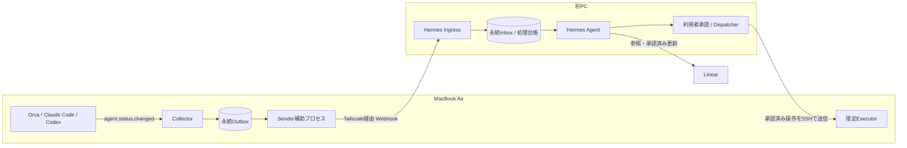

# Orca Webhook Bridge プラグイン仕様書

- 文書バージョン：1.0
- 作成日・公開情報の確認日：2026年10月21日（日本時間）
- 文書の位置づけ：実装に向けた設計仕様。稼働済みの製品やプラグインを示すものではない。
- 対象環境：MacBook Air／macOS／Orca／Claude Code・Codex、別PC上のHermes Agent、Linear、TailscaleとSSH

## 1. 目的と基本方針

MacBook Air上のOrcaが公開するエージェント状態イベントを収集し、別PCで動作するHermes AgentへWebhookで伝える。Hermesは受信した状態を整理し、必要な通知、Linear Issueとの関連付け、承認を伴う操作の提案につなげる。

MacBook Airがスリープ・オフラインの間は、そのMacへの接続と操作をスキップする。保存済みイベントと保留タスクは破棄せず、復帰後に用途別の条件を満たすものを再送・再評価する。古い状態イベントを受け取っただけで、過去に提案された操作を実行してはならない。

本仕様の中心は次の5点とする。

1. `agent.status.changed`を購読し、構造化した状態変化を送る。
2. ネットワーク送信より先にローカルの永続キューへ保存する。
3. 再送を前提とし、受信側の重複排除と処理記録で二重処理を抑止する。
4. 状態通知と操作要求を分離し、書き込み操作は個別の承認と実行直前の再確認を通す。
5. 公開情報で確認できたこと、利用環境の前提、今回の設計案、要検証事項を混同しない。

## 2. 確認状況と根拠

### 2.1 表記の意味

| 表記 | 意味 |
| --- | --- |
| **確認済（依頼条件）** | 今回の依頼で指定された前提。実機の設定・稼働状況まで確認した意味ではない。 |
| **確認済（公開情報）** | 確認日時点の公式文書または公開ソースで裏付けた情報。利用中の配布版と一致する保証はない。 |
| **設計案** | 本プラグインと周辺コンポーネントに実装する仕様。既存製品に備わる機能とは限らない。 |
| **要検証** | 利用版・実機・連携先での確認が必要。確認するまで、その能力に依存する自動操作は有効化しない。 |

特記のない動作、数値、独自フィールド、エンドポイントはすべて**設計案**である。

### 2.2 確認済事項

| ID | 区分 | 確認内容 | 根拠・限界 |
| --- | --- | --- | --- |
| C01 | 依頼条件 | MacBook AirでOrcaを使い、Claude CodeとCodexを利用する。 | 今回の依頼。OS・各アプリのバージョンは未確認。 |
| C02 | 依頼条件 | Hermes Agentは別PC、LinearはIssue管理、接続はTailscale＋SSHとする。 | 今回の依頼。別PCのOS・常時稼働性は未確認。 |
| C03 | 公開情報 | Orcaのプラグイン機構はExperimentalとして案内され、プラグインごとの有効化と同意がある。ワーカーはローカルPCで動く。 | [Orca設定リファレンス](https://www.onorca.dev/docs/settings)。利用版への搭載は要検証。 |
| C04 | 公開情報 | 公開イベント集合に`agent.status.changed`、`worktree.created`、`worktree.removed`が存在する。 | [manifest定義](https://github.com/stablyai/orca/blob/main/src/shared/plugins/plugin-manifest.ts)。 |
| C05 | 公開情報 | 状態イベントの必須項目は`worktreeId`、`paneKey`、`state`、`receivedAt`。現在の公開定義には任意の`mainAgent`もある。 | [イベント定義](https://github.com/stablyai/orca/blob/main/src/shared/plugins/plugin-events.ts)。`state`は列挙型ではなく文字列。 |
| C06 | 公開情報 | `state`は子エージェントを含む合成状態。任意の`mainAgent`には主エージェントの状態、任意の結果、状態開始時刻が含まれる。 | 同上。古いホストや情報のない行では`mainAgent`が欠ける。 |
| C07 | 公開情報 | manifestのイベント宣言はワーカー起動の契機になる。動的な購読はそのワーカーの存続期間に限られる。 | [event bus](https://github.com/stablyai/orca/blob/main/src/main/plugins/plugin-event-bus.ts)。これはイベント履歴の永続化を意味しない。 |
| C08 | 公開情報 | 公開Host APIに`events.subscribe`、ストレージ、秘密情報、設定、通知表示、明示したターミナルへの入力がある。 | [Host API](https://github.com/stablyai/orca/blob/main/src/shared/plugins/plugin-host-api.ts)。一般の通知を読むAPIとは異なる。 |
| C09 | 公開情報 | Orcaのエージェント状態フックは`working`／`waiting`／`done`をUIに報告するものとして説明されている。 | [Agent hooks & memory](https://www.onorca.dev/docs/agents/hooks-memory)。各CLIでの実際の遷移は要検証。 |
| C10 | 公開情報 | 通常のSSHをTailscaleのネットワーク上で使う構成と、製品機能の「Tailscale SSH」は区別される。後者のmacOSサーバーには配布形態の条件がある。 | [Tailscale SSH](https://tailscale.com/kb/1193/tailscale-ssh)。本仕様では通常のSSH over Tailscaleを基本とする。 |
| C11 | 公開情報 | Hermesの公式文書にWebhook受信機能と署名方式がある。 | [Hermes Webhooks](https://hermes-agent.nousresearch.com/docs/user-guide/messaging/webhooks)。利用中の版への搭載と設定は要検証。 |
| C12 | 公開情報 | Hermesの現在の公開コードでは、通常のagent経路と、coalesce・cron・直接配信等の経路で受領・重複排除の扱いが異なる。 | [Webhook実装](https://github.com/NousResearch/hermes-agent/blob/main/gateway/platforms/webhook.py)。すべての2xxが同じ永続保証を持つとは扱わない。 |

### 2.3 実機確認の限界

本仕様は依頼条件と一次資料をもとに構成した。作成時点では、利用中のOrcaバージョン、イベント購読の実動作、署名付き通信、SSH操作を実機で検証していない。公開ソースへのリンクは可変の`main`を含むため、実装開始時に利用版と対応するcommitを記録する。

本リポジトリの実装で確認できた事項と残りの要検証事項は、READMEの該当節を参照する。

## 3. 役割と構成

### 3.1 コンポーネント

| コンポーネント | 稼働場所 | 責務 |
| --- | --- | --- |
| Orca | MacBook Air | Claude Code・Codexの作業環境と状態イベントの発生元。 |
| Webhook Bridge Collector | Orcaプラグインワーカー | 購読、検証、正規化、状態比較、永続キューへの書き込み。 |
| Webhook Bridge Sender | MacBook Airの同一ユーザーの補助プロセス | キューの読み出し、署名、送信、再送、復帰後の再開。 |
| Hermes Ingress | Hermes側PC | 署名検証、送信元許可、永続受信、重複排除、状態投影。新規の受信アダプター案。 |
| Hermes Agent | Hermes側PC | 状況の要約、通知方針、Issueの参照、操作案の作成。 |
| Approval Dispatcher／Executor | Hermes側／Mac側 | 承認の管理、SSH経由での限定操作、実行記録。段階導入の後半で追加。 |
| Linear | クラウド | Issueの記録と業務上の進行管理。イベント輸送路・実行キューには使わない。 |

本書のHermesは[NousResearch/hermes-agent](https://github.com/NousResearch/hermes-agent)を想定する。実際の配布版・導入方法は導入前に確認する。



### 3.2 プラグイン単体と補助プロセスの境界

**推奨構成は、CollectorをOrcaプラグイン、SenderをログインユーザーのLaunchAgent等で管理する補助プロセスに分ける方式**とする。CollectorとSenderは、同じBridge専用ディレクトリのSQLite Outboxを共有する。

理由は、プラグインワーカーの常駐、アイドル回収後の再起動、起動直後の処理、OS復帰イベントの取得を未検証のまま前提にできないためである。公開のワーカー実装にもアイドル管理のための情報がある。[ワーカープロセス実装](https://github.com/stablyai/orca/blob/main/src/main/plugins/plugin-host-process.ts)

補助プロセスは新たに実装・導入するものとし、Orca標準機能とは案内しない。常駐の導入と外部送信の許可を設定時に明示する。ワーカー単体方式への簡略化は、「復帰・再起動後、新規イベントなしでも再送できる」ことを実機で確認できた場合に限る。

CollectorによるSQLite利用、Node実行環境との互換性、保存先アクセス、補助プロセスの起動管理は**要検証**。不成立ならローカルIPCで専用永続化サービスへ受け渡す実装へ切り替えるが、その場合もサービスの保存完了が保証開始点となる。

## 4. 対象範囲と対象外

### 4.1 対象範囲

- `agent.status.changed`の収集とWebhook送信。
- 明示的に対応付けたWorktree／PaneとLinear Issueの関連付け。
- 永続Outbox・Inbox、再送、重複排除、署名、監査ログ。
- 通信不能時のスキップと保留、復帰後の送信再開。
- Hermesでの状況把握、通知の集約、操作の提案。
- 後続段階で、承認付きの限定操作とその結果確認。

### 4.2 初期版の対象外

- macOS通知センター内の全アプリ通知の取得、通知DBの読み取り、画面や通知バナーのOCR。
- Orcaの通知本文、AIの回答全文、プロンプト、ターミナル全出力の自動転送。
- 非公開RPC、内部DBの直接変更、他プラグインの秘密情報へのアクセス。
- `done`だけを根拠にしたLinearの自動完了、PRのマージ、本番デプロイ。
- スリープの強制解除、蓋を閉じたMacの常時稼働、電源断中の実行。
- 任意シェルコマンドを受け付ける汎用リモート実行API。
- Orcaの通常ターミナルとSSHセッションが同じ作業状態を持つとの仮定。
- 認証情報の同期、Claude Code・Codexの購読情報の共有。
- 停止中に観測できなかった全イベントの完全復元。
- インターネット公開Webhook、Tailscale Funnel、他OS対応。必要になった時点で別途設計する。

## 5. 通知と状態イベントの違い

| 項目 | macOSの表示通知 | Orcaの状態イベント | Bridgeが作る通知 |
| --- | --- | --- | --- |
| 主目的 | 人に知らせる | ソフトウェアへ状態変化を伝える | 状態から利用者への連絡を作る |
| 例 | 「作業が終わりました」というバナー | `agent.status.changed`と構造化データ | 「確認が必要な作業が2件あります」 |
| UI設定の影響 | 集中モード、通知許可等の影響を受け得る | バナー表示の有無と同じとは限らない | 連絡先と通知ルールに従う |
| 本文取得 | 本仕様では取得しない | 回答本文があるとは想定しない | 必要な状態項目から生成する |
| 一対一対応 | 状態イベントとの一致を保証しない | 1回の変化で表示通知が出るとは限らない | 複数イベントを要約できる |

`notifications.show`はプラグイン自身が通知を表示するAPIであり、OrcaやmacOSの既存通知を読む購読APIではない。[Orca Host API](https://github.com/stablyai/orca/blob/main/src/shared/plugins/plugin-host-api.ts)

本仕様が実現するのは「Orcaの状態をHermesへ伝え、Hermesが処理する」経路である。Orcaが表示したすべての通知を、そのまま外へ転送する保証は含めない。

## 6. イベントの取得・意味付け

### 6.1 購読

manifestの`contributes.events`に`agent.status.changed`を宣言する。ワーカー起動時のSDKで必要なハンドラーを登録する。動的な`events.subscribe`だけに依存しない。実際のSDKの登録記法とmanifest購読時の動的購読の要否は、利用版で確認する。

`worktree.created`／`worktree.removed`は将来の関連付け更新用の任意購読とし、MVPでは必須にしない。購読を増やす場合は、追加で取得するパス等の情報も送信対象として説明する。

### 6.2 元イベントの扱い

| 元項目 | 公開定義で確認できた内容 | Bridgeでの扱い |
| --- | --- | --- |
| `worktreeId` | 文字列または`null` | `null`を許容。無関係なIssueへ推定で紐付けない。 |
| `paneKey` | 文字列 | 発生元の識別材料。秘密情報やファイルパスだとは決め付けず、扱うデータとして開示する。 |
| `state` | 文字列 | 原値を保存し、既知の値だけ表示用に正規化する。 |
| `receivedAt` | 正の有限数値 | 原値を保持。単位・時計の由来は利用版で確認してから日時へ変換する。 |
| `mainAgent` | 任意のオブジェクト | あれば保持。未搭載版では欠落を正常とする。 |
| `mainAgent.state` | 文字列 | 合成状態と別に管理する。 |
| `mainAgent.outcome` | 任意の文字列 | 完全な値集合と意味を確認するまで成功判定へ使わない。 |
| `mainAgent.stateStartedAt` | 有限数値 | 実行ホストの時計由来。Bridgeの観測時刻との直接比較は慎重に行う。 |

上記は[Orcaの公開イベント定義](https://github.com/stablyai/orca/blob/main/src/shared/plugins/plugin-events.ts)に基づく。元定義の全ソースを転送せず、必要な項目だけを選ぶ。

### 6.3 正規化と判定

| 観測値 | Bridgeの表示用状態 | 可能な解釈 | 自動判断してはいけないこと |
| --- | --- | --- | --- |
| `working` | `working` | エージェントまたは子が動作中。 | 主エージェントが必ず作業中である。 |
| `waiting` | `waiting` | 入力・確認等を待っている可能性。 | 必ず権限承認待ちである。質問や承認の本文が取得できる。 |
| `done` | `done` | ターン等が終了した状態として観測された。 | 作業成功、テスト合格、Issue完了。 |
| 未知の文字列 | `unknown` | 未対応の状態。 | エラーや成功へ強制的に対応付ける。 |

- `state=working`でも`mainAgent.state=done`が届く場合は、子が継続中の可能性を表示する。
- `mainAgent`だけの変化も意味のあるイベントとして扱う。合成状態が同じという理由で捨てない。
- `error`、`failed`、`cancelled`、承認待ち等の専用値が存在するかは要検証。独自のイベント名をOrcaの既存イベントとして説明しない。
- Claude Code／Codexの識別子、回答本文、確実な実行IDが元イベントにあるとは想定しない。プロバイダー情報は明示設定等で確認できた場合だけ付与し、未確定は`null`とする。

## 7. Bridgeイベント契約

### 7.1 イベント種別

| `event_type` | `kind` | 発生条件 |
| --- | --- | --- |
| `agent.status.changed` | `state_change` | Orcaから受け取った新しい観測。 |
| `bridge.lifecycle` | `lifecycle` | Senderの起動・復帰検出、収集障害、設定に基づく再同期開始等。Bridge独自。 |
| `bridge.observation.snapshot` | `snapshot` | サポートされた読取手段で現状態を取得できた場合のみ。Bridge独自、後続段階。 |

操作要求はこのイベント経路に混在させず、第15章の操作契約を使う。Heartbeatは任意のヘルス経路とし、Orcaの実行状態イベントを装わない。

### 7.2 共通フィールド

| 項目 | 必須 | 仕様 |
| --- | --- | --- |
| `schema_version` | 必須 | 本契約の版。初期値`1`。 |
| `event_id` | 必須 | 初回保存時に生成するUUID等。全再送で不変。 |
| `event_type`／`kind` | 必須 | 第7.1節による。 |
| `observed_at` | 必須 | Bridgeが観測したUTCのRFC 3339日時。元イベント発生時刻の保証ではない。 |
| `source.device_id` | 必須 | 手動登録した永続的な端末ID。端末名やIP変更で変えない。 |
| `source.epoch` | 必須 | Outbox世代ID。DBの再構築等でのみ更新し、通常の再起動では維持する。 |
| `source.orca_version` | 必須 | 確認できた版、未取得は`null`。推定で埋めない。 |
| `source.plugin_version` | 必須 | Bridgeの版。 |
| `stream.id`／`stream.sequence` | 必須 | 発生元の論理ストリームと永続的な単調増加番号。1から開始。 |
| `context.worktree_id`／`context.pane_key` | 状態イベントで必須 | 元IDを保持。`worktree_id`は`null`可。 |
| `context.provider` | 任意 | `claude_code`／`codex`等。明示的な根拠がなければ`null`。 |
| `context.linear_issue` | 任意 | 登録済みIssueのID・表示識別子。未登録は`null`。 |
| `data` | 必須 | 種別ごとの本文。操作命令は含めない。 |

`stream.id`は端末・世代・Worktree・PaneとBridge側の対応付けから作る不透明なIDとする。元データに確実なセッションIDがない場合、これはエージェントの実行IDを保証しない。Paneの再利用やセッション交代を検出できなければ、操作前に追加確認を要求する。

`observed_at`と`stream.sequence`はそれぞれ時刻と収集順序を表し、業務上の因果関係やプロバイダー内部の実行順序を保証しない。

### 7.3 状態イベントのサンプル

次は本Bridgeの独自エンベロープの例であり、OrcaがこのJSONを直接発行するわけではない。識別子は架空。`received_at_raw`の数値は、利用版でミリ秒であることを検証した場合の例とする。

```json
{
  "schema_version": 1,
  "event_id": "ca387f71-5a2a-4d98-87c7-eed8bda116aa",
  "event_type": "agent.status.changed",
  "kind": "state_change",
  "observed_at": "2026-10-21T01:00:00.000Z",
  "source": {
    "device_id": "macbook-air-01",
    "epoch": "8fa3651a-96b6-4b5c-a154-d8f245848980",
    "orca_version": null,
    "plugin_version": "0.1.0"
  },
  "stream": {
    "id": "stream-71fa3dd7",
    "sequence": 42
  },
  "context": {
    "worktree_id": "wt-example-01",
    "pane_key": "pane-example-02",
    "provider": null,
    "linear_issue": {
      "id": "c357b0a8-8c73-4566-aafc-2b3408f21bf6",
      "identifier": "DEV-123"
    }
  },
  "data": {
    "previous_state": "working",
    "state": "waiting",
    "normalized_state": "waiting",
    "received_at_raw": 1792544400000,
    "main_agent": null,
    "evidence": "orca_plugin_event"
  }
}
```

`previous_state`は同じストリームでBridgeが直前に観測した状態であり、未観測・収集の空白がある場合は`null`とする。元の状態名と正規化値を両方保存する。`main_agent`があれば元項目を同名・同型で選択的に格納し、任意項目の欠落を許容する。

## 8. 永続キューと保存保証

### 8.1 保存方式

Bridge専用SQLiteを採用する案とし、トランザクション、WAL、適切な同期設定、排他制御、起動時の回復処理を実装する。保存先はインストール先やリポジトリとは分ける。

```text
~/Library/Application Support/OrcaWebhookBridge/
  config.json
  outbox.sqlite3
  logs/
```

これはBridgeが提案する保存先であり、Orca標準の保存場所ではない。ディレクトリはユーザー専用、ファイルは他ユーザーが読めない権限とする。WAL・共有メモリファイルも同様に保護する。SQLite自体の暗号化は初期版の保証に含めず、本文の最小化とOSの保存領域保護を前提にする。

OrcaのHost APIストレージには公開定義上、値あたり256 KiB、合計5 MiB、1024キーという上限がある。大きなキューとトランザクション処理をこのKey-Value APIだけで賄えるとは扱わない。[Host APIの上限定義](https://github.com/stablyai/orca/blob/main/src/shared/plugins/plugin-host-api.ts)

### 8.2 保存する情報

| テーブル等 | 主な内容 |
| --- | --- |
| `outbox_events` | `event_id`、不変の送信本文バイト列、本文SHA-256、ストリーム、番号、観測時刻、状態、試行回数、次回試行、最終エラー、配送先ID。 |
| `source_state` | 端末・世代、ストリームの次番号、前回観測値、関連付け情報。 |
| `source_fingerprints` | 元イベントの完全一致検出用ハッシュと保存済みイベントの対応。 |
| `delivery_attempts` | 試行時刻、配送結果、HTTPコード、応答の安全な要約、追跡ID。 |
| `runtime_control` | 送信の有効・停止、リース、設定リビジョン。秘密情報は入れない。 |

イベント登録、番号採番、前回状態の更新、完全一致キーの登録は同一トランザクションで行う。途中終了で「番号だけ進む」「状態だけ更新され、イベントがない」状態を作らない。

### 8.3 保証の開始点

1. Collectorが元イベントを受け取る。
2. 入力検証・対象判定・正規化を行う。
3. Outboxに永続コミットする。
4. イベントハンドラーを完了し、Senderが別処理として送信する。

**保存済みと呼べるのは3が完了した後だけ**である。1から3の間のクラッシュ、Orcaが未発行・未配信のイベント、収集停止中のイベントは保証外とする。公開のOrca配信コードには配信失敗時のdrop処理があり、Bridgeがホスト側の無損失配送を保証することはできない。[イベント配信実装](https://github.com/stablyai/orca/blob/main/src/main/plugins/plugin-event-delivery.ts)

ネットワーク送信やHermesの処理完了をイベントハンドラー内で待たない。ローカル書き込みに失敗したら、収集障害を可視化する。外部送信だけ続けて正常保存を装ってはならない。

### 8.4 キューの状態と上限

```text
pending → inflight → delivered
               └→ retry_wait → inflight
               └→ blocked_config
               └→ dead_letter
```

- `inflight`には期限付きリースを設け、Sender異常終了後に未完了の試行を回収する。
- 初期上限案：未達100,000件またはDB・WALを含む256 MiBのどちらかに達したら収集を縮退し、警告する。ディスク空き容量の下限も設ける。
- 未達イベントは黙って古いものから削除しない。満杯以後に保存できなかった範囲を障害として記録し、観測の連続性を失ったことを表示する。
- 自動再送の期限案は観測から30日。超過した未達は期限切れDead Letterとして保留し、送信や削除を利用者が判断する。
- 配送済み本文は7日、配送試行ログは30日を初期保持案とする。Dead Letterの本文は自動削除しない。
- 受信側の重複判定用`event_id`・本文ハッシュの墓標は送信元の運用期間中保持し、古い手動再送にも対応する。本文は90日等の別ルールで削除可能とする。
- 容量・保持期間は計測後に調整する。有限容量で無期限の無損失を保証する表現は使わない。

## 9. 重複排除と順序

### 9.1 二段階の重複排除

**送信前の完全一致排除**：端末・世代・ストリーム・選択した元イベント全項目の正規化ハッシュを用いる。`receivedAt`、任意の`mainAgent`も含める。完全一致を再受信した場合は既存イベントに対応付ける。

`state`だけをキーにしない。`working → waiting → working`の2回の`working`や、主エージェントだけの変化は別イベントである。同状態の連続観測を抑える機能は、元イベントの意味を検証するまで無効とする。

**受信時の配送重複排除**：`(source.device_id, source.epoch, event_id)`を一意キーにし、本文ハッシュを比較する。

- 同じID・同じ本文：既存の受領結果を返し、通知・操作を再実行しない。
- 同じID・異なる本文：`409`相当で拒否し、競合を監査記録する。
- 再送ごとに新しい`event_id`を生成しない。署名ヘッダーと試行情報だけを更新する。
- 受信応答が消失した場合も同じIDで再送する。Senderは推測で配送済みにしない。

### 9.2 順序と古い状態

- 同じストリームは原則1件ずつ順に送信し、別ストリームは並行可能とする。
- 受信側は各ストリームの最大適用番号を保持する。遅れて届いた古い番号は履歴に残し、現状態を巻き戻さず、新規の副作用を起こさない。
- 番号欠落は記録する。Dead Letter等で欠番が生じても、別ストリームを止めない。同じストリームを先へ進める場合も欠落表示を残す。
- 端末間の全順序は作らない。時計のずれを順序判定の代用にしない。
- 世代変更時は新ストリームとして登録し、過去の最大番号を上書きしない。

配送は**at-least-onceを目指す設計**とし、重複排除後の処理も冪等化する。任意の外部操作に対するexactly-onceを保証しない。

## 10. Webhook配送と署名

### 10.1 経路

Mac → Hermes側PCのHTTPSエンドポイントへ、Tailscale経由で送る。基本URL案は次とする。

```text
POST https://hermes-host.example-tailnet.ts.net/bridge/v1/events
```

上記ホスト・パスは設計上の例。証明書、名前解決、Tailscale ACL／Grants、待受アドレスとホスト側ファイアウォールを実環境に合わせる。パブリック側から到達可能な`0.0.0.0`への無制限公開を既定にしない。

Webhook用HTTPSと、Hermes → Macの操作用SSHは別経路である。Webhookを送るためにSSHセッションを維持する必要はない。

### 10.2 署名方式

Hermesが公開するGeneric V2の形式に合わせる案を採用する。公開文書では`X-Webhook-Timestamp`と`X-Webhook-Signature-V2`、タイムスタンプ付きHMAC-SHA256が説明されている。[Hermesの署名仕様](https://hermes-agent.nousresearch.com/docs/user-guide/messaging/webhooks)

```text
Content-Type: application/json; charset=utf-8
X-Request-ID: <event_id>
X-Webhook-Timestamp: <送信試行時のUnix秒>
X-Webhook-Signature-V2: <64文字の小文字hex>
X-Bridge-Key-Id: <既知の鍵識別子。Bridge受信アダプター独自>
X-Bridge-Attempt: <1から始まる試行回数。監視用>

signed_bytes = ASCII(timestamp) + "." + raw_body_bytes
signature = hex(HMAC_SHA256(secret_bytes, signed_bytes))
```

- 鍵は十分な乱数から生成し、初期案は32バイト相当以上とする。使用する文字列表現とエンコードを双方で固定する。
- JSONの再整形・改行追加後に検証しない。保存した送信本文の**実際のバイト列**を署名し、受信時もraw bodyで検証する。
- 署名比較は定数時間比較を使う。許容時差案は±300秒。端末の時刻同期を前提条件にする。
- スリープ前の古い署名を再利用しない。復帰後は同じ本文・同じIDに、現在の送信時刻で新しく署名する。
- `observed_at`は変更しない。古い出来事の新しい配送であることを区別する。
- `X-Request-ID`は署名済み本文の`event_id`と一致することを検証する。未署名ヘッダーだけを重複判定の権威にしない。
- 鍵ID・試行回数のヘッダー自体には業務上の権限を持たせない。未知の鍵IDは拒否し、認証成功前にイベントを受理しない。
- HMACは送信者を認証するものであり、データ本文を安全な命令に変換するものではない。

### 10.3 秘密情報とローテーション

- Collectorの設定本文、リポジトリ、ペイロード、通常ログへ秘密を保存しない。
- プラグインがOrcaの`secrets` APIを使う場合も、別プロセスが同じVaultを直接読めるとは仮定しない。
- 推奨構成ではSenderがユーザーのKeychain等を使い、CollectorはWebhook署名鍵を持たなくてよい。秘密の保存方法とKeychainのロック時挙動は要検証。
- 鍵更新時は受信側が旧・新を一時的に許可し、Sender切り替えを確認して旧鍵を無効化する。本文とイベントIDは変えない。
- Hermes内蔵受信へ直接送る場合、独自の鍵IDや複数鍵の検証がそのまま使えるとは限らない。利用版で確認する。
- 鍵が取得できない間は送信を保留する。署名を省略した送信へフォールバックしない。

### 10.4 受領応答

Bridge Ingressの応答案を以下とする。

```json
{
  "status": "accepted",
  "event_id": "ca387f71-5a2a-4d98-87c7-eed8bda116aa",
  "durable": true
}
```

| 条件 | 応答案 | Senderの扱い |
| --- | --- | --- |
| 新規イベントを永続保存済み | `202`＋`accepted`＋一致するID＋`durable: true` | 配送済み。Hermesの業務処理は別途追跡。 |
| 既存の同一イベント | `200`＋`duplicate`＋一致するID＋`durable: true` | 配送済み。 |
| 永続保存前に停止・容量不足 | `503`等 | 再送。成功応答は禁止。 |
| IDと本文の競合 | `409` | 自動再送を停止し、隔離・調査。 |

任意の2xx、空の`204`、プロキシのHTML応答を成功とは扱わない。契約した応答とIDを照合する。`accepted`は永続受領を示し、要約・通知・Linear更新の完了ではない。

## 11. Hermes側受信と処理

### 11.1 永続Inbox

受信側は次の順序で処理する。

1. 経路・送信元・サイズ制限を検査する。
2. raw bodyと時刻を使って署名を検証する。
3. JSONスキーマ、許可した端末・世代、本文ID、ヘッダーIDの一致を検査する。
4. Inboxと重複判定台帳を同一トランザクションで保存する。
5. 永続受領の応答を返す。
6. 別ワーカーで状態投影、通知判断、Hermesへの処理依頼を行う。

Inboxの処理状態は`received`／`processing`／`processed`／`processing_failed`等で持つ。Hermes停止・モデル障害・Linear障害はInbox内で再試行し、Macからの再送とは分ける。受領済みイベントを失った場合は受信側の障害であり、Mac側が常に復旧させる設計にはしない。

### 11.2 Hermes内蔵Webhookとの使い分け

公開文書の内蔵ルート例は`/webhooks/<route-name>`である。本書の`/bridge/v1/events`は独自の受信契約であり、Hermesの既存URLではない。[Hermes Webhooks](https://hermes-agent.nousresearch.com/docs/user-guide/messaging/webhooks)

現在の公開コードの通常agent経路には、永続admissionの結果を待って`accepted`／`duplicate`を返し、受付不能時に`503`を返す処理がある。一方、coalesce・cron・直接配信等は別扱いである。[該当実装](https://github.com/NousResearch/hermes-agent/blob/main/gateway/platforms/webhook.py)

導入時は、次のどちらかを選んで記録する。

| 方式 | 適用条件 |
| --- | --- |
| **推奨：Bridge Ingressを設ける** | 本仕様の永続Inbox、長期の重複判定、状態順序制御を自前で満たし、必要なイベントだけをHermesへ渡す。 |
| **簡略化：Hermes内蔵受信を使う** | 利用版・経路の永続性、再起動後の重複排除、ID競合、処理順序、権限制限を実証できた場合。応答パーサーをHermesの実際の`delivery_id`等へ合わせる。 |

公開文書には1時間の重複キャッシュの説明もあるが、それだけで長期再送の要件を満たすとはしない。最新コードの永続admissionとの対応、保持期間、各モードの保証は実機で確認する。既存機能がないとも、すべてのモードで同じ保証があるとも断定しない。

### 11.3 Hermesに許可する処理

- 初期段階：状態保存、要約、利用者向け通知案、紐付け済みIssueの読取。
- 外向き通知は設定時に許可した宛先・種別・頻度だけで実行する。
- ログやIssue本文はデータとして扱い、その中の文言を操作権限とみなさない。
- ルールで済む状態更新は決定的な処理で行い、全イベントでLLMを起動しない。
- Webhookを受けるHermesのプロファイルには、必要なツールだけを許可する。通知用プロファイルに無制限のSSH・書込権限を持たせない。
- 任意に作成した受信ルートから、別PCの全権限を継承できる構成にしない。

## 12. 再送・障害対応

### 12.1 再送ルール

- 接続タイムアウト3秒、リクエスト全体10秒を初期案とする。
- 再送待ちは指数バックオフ＋ランダムな揺らぎとし、目安は5秒、15秒、45秒、2分、5分、以降15分上限。
- 初回を除く待ち時間の例は目安であり、厳密な時刻実行を保証しない。`Retry-After`が妥当な場合は下限として尊重する。
- 回線断・スリープ等で実際に送信しなかった回は、配送試行回数に含めない。接続を試みて失敗した回は含める。
- 復帰・ネットワーク回復を検出したら、対象配送先につき1件を試し、回復後に順次キューを流す。一斉再送を避ける。
- 初期の配送レート案は全体10件／秒、同時接続2、同一ストリーム1。Hermes側の許容レートに合わせてさらに絞る。

### 12.2 エラー別の扱い

| 結果 | 扱い |
| --- | --- |
| DNS失敗、接続拒否、タイムアウト、切断 | `retry_wait`。到達不能として再確認を間引く。 |
| `408`／`429`／`5xx` | 再送対象。`Retry-After`、送信量制御を適用。 |
| `400`／`413`／`422` | 本文または契約不整合。Dead Letterへ隔離し、同じ本文を高速再送しない。 |
| `401`／`403` | 署名・時刻・権限・停止設定を確認。`blocked_config`として配送先を一時停止。 |
| `404` | URL・ルート設定を確認。設定修正まで保留。 |
| `409` | ID衝突・本文競合として隔離。 |
| `3xx` | 自動追従しない。設定修正を要求し、署名付き本文の別宛先への流出を防ぐ。 |
| TLS証明書エラー | 配送先を保留し警告。検証無効化へ切り替えない。 |
| 不正な成功応答・ID不一致 | 配送済みにしない。再試行を間引き、契約不整合を表示。 |

配送先URL変更時は、既存イベントを無関係な新URLへ自動転送しない。キューに紐付いた配送先IDを維持し、移管するイベントと新しい宛先を利用者に提示する。

## 13. スリープ・オフライン・復帰

### 13.1 「スキップ」の定義

スキップとは**今回の接続・操作の試行を行わず、必要な記録を保留すること**であり、イベントやIssueを削除・完了することではない。

| 状況 | Mac側のイベント送信 | Hermes側からMacへの接続・操作 |
| --- | --- | --- |
| Macが起動中、Orcaも動作、両PCが疎通可能 | 保存後に順次送信。 | 許可範囲の読取。書込は承認後。 |
| Macは起動中だがオフライン | 状態イベントを保存。送信は保留。 | 接続不能なら今回分をスキップ。タスクを`deferred_unreachable`にする。 |
| Macがスリープ | 実行継続・新規収集を保証しない。保存済みOutboxは維持。 | 到達不能としてスキップ。スリープか回線断かは断定しない。 |
| Macがシャットダウン | 同上。電源断中の処理はない。 | 保留。強制起動しない。 |
| Macは起動中、Orcaだけ終了 | Senderは保存済みOutboxを送信可能。新規のOrcaイベント収集は停止。 | SSH接続だけでOrcaの対象が操作可能とは扱わない。 |
| Hermes側PCが停止 | MacのOutboxに蓄積。 | Hermesの処理も停止。復旧後に再開。 |
| Mac復帰、ネットワークは未回復 | Senderは疎通を待ち、低頻度で確認。 | 実際の到達性が確認できるまで保留。 |
| 鍵がロック中 | 署名付き送信を保留。 | 承認・実行鍵が使えなければ保留。 |

### 13.2 復帰手順

1. Senderの起動・復帰検出・最大60秒周期の軽量確認等を契機に、期限切れリースを回収する。
2. 送信の有効状態、DBの健全性、鍵、配送先、時刻同期、ネットワークを確認する。
3. 未達を同じイベントID・本文で、新しい署名により再送する。
4. Hermesは過去のイベントを履歴として受領し、順序と観測時刻から最新表示を更新する。
5. 利用可能な現状態取得手段があれば再同期する。なければ「最終観測時点の状態」と表示する。
6. 保留タスクは対象・期限・承認・現在の状態を再評価し、有効なものだけ次の段階へ進める。

復帰後の再送は**すでに永続保存されたイベント**に対して保証を設計する。スリープ中に発生しなかったイベントや、Orca終了中に取り逃した変化を作り直さない。現状態のスナップショットも、空白期間の履歴を復元したことにはならない。

### 13.3 到達性と通知抑制

- HermesはHeartbeatの欠落だけで「Macがスリープした」と断定せず、`unreachable`／`unknown`として扱う。
- Heartbeat案は60秒間隔、180秒超の欠落で到達性を不明にする。ただし業務状態は別に保持する。
- Senderの生存とCollector／Orcaの生存は別項目で報告する。Senderが動いていても「Orcaの状態が最新」と表示しない。
- 瞬間的な不通では毎回利用者へ通知しない。継続障害、復旧、キュー増大、利用者操作が必要な場合に集約して通知する。
- 復帰時の過去の`waiting`等をそのまま緊急通知しない。過去の変化を要約し、現在も対応が必要かを確認する。

### 13.4 Hermes側の保留タスク

Macに依存するタスクは、Hermes側の永続台帳に`task_id`、対象端末、操作案、保留理由、次回確認予定、有効期限、承認参照を保存する。定期確認のたびに同じタスクを新規作成せず、既存の保留記録を更新する。

復帰後は、読取タスクなら対象と期限を照合して再開し、書込タスクなら第15章の承認を再検証する。タスクの再開・操作要求の再配送は、過去の状態イベントの再送とは別の処理である。Macへの接続を必要としないHermes側の要約やIssue参照は、別の依存関係がなければ継続できる。

## 14. Tailscale＋SSH接続

### 14.1 接続方式

基本構成は、Macの通常のSSHサーバーへTailscaleのアドレス／MagicDNS名で接続する方式とする。macOSは「リモートログイン」によるSSH接続を提供している。[Appleのリモートログイン説明](https://support.apple.com/guide/mac-help/allow-a-remote-computer-to-access-your-mac-mchlp1066/mac)

「Tailscale SSH」を採用する場合は別途適合確認を行う。公式資料にはmacOSサーバーについてオープンソースの`tailscale`＋`tailscaled`版という条件があるため、App Store版等でも同じ機能が使えるとは仮定しない。[Tailscaleの条件](https://tailscale.com/kb/1193/tailscale-ssh)

### 14.2 運用制約

- 接続元、宛先、ユーザー、ポートを制限し、不要なrootアクセスを与えない。
- 通常SSHでは専用鍵とホスト鍵検証を使う。未知・変更されたホスト鍵を無視しない。
- 無人の到達確認は短いタイムアウトを設け、対話的なパスワード入力で停止しない。
- 管理者権限、画面操作、フルディスクアクセスを初期要件にしない。
- 非対話SSHから、ログイン中ユーザーのOrca CLIやGUIセッションへ届くかは要検証。接続成功と操作成功を分けて記録する。
- 原則として固定のExecutorと構造化JSONを使う。外部由来のIssue本文やIDをシェルコマンドに連結しない。

本仕様は接続方式を定めるものであり、この文書の作成に伴ってリモートログインやTailscaleの設定を変更するものではない。

## 15. 承認付き操作

### 15.1 権限の段階

| 段階 | 例 | 許可条件 |
| --- | --- | --- |
| 状態収集・受信 | イベント保存、状態表示 | 導入時に送信範囲・宛先を許可。 |
| 読取 | 関連Issueの参照、許可済み状態照会 | 対象を限定した読取権限。 |
| 外向き連絡 | 指定チャネルへの集約通知 | 宛先・内容・頻度を設定で明示許可。未許可宛先は個別承認。 |
| 書込・実行 | エージェントへの追加指示、再試行、停止、Issue更新 | 操作内容・対象ごとの明示承認と実行直前検証。 |
| 初期対象外 | マージ、デプロイ、権限変更、秘密の取出し | 汎用の許可で有効化しない。別仕様が必要。 |

Orcaのプラグイン導入同意、Tailscale SSHの接続認可、具体的な操作の承認は別物である。導入時の`terminal:send`同意だけで、以降すべての入力が利用者承認済みになる設計にしない。

### 15.2 承認フロー

1. Hermesがイベントをもとに操作案を作る。
2. 認証された承認画面・チャネルで、対象端末、Worktree、Pane、Issue、操作内容、予想される変更、期限を提示する。
3. 利用者がその操作案を明示承認する。状態イベントやLLMの出力だけでは承認済みにしない。
4. Dispatcherは承認記録を検証し、対象Macの到達性と現在の対象状態を確認する。
5. Executorが許可済み操作だけを実行し、操作台帳へ結果を記録する。
6. Hermesは結果を確認し、承認された範囲で報告・Issue更新を行う。

承認画面・認証・通知先・承認記録は今回新たに設計する領域であり、Orcaの既存APIが同じUIを提供すると断定しない。

### 15.3 操作要求のサンプル

次は追加指示を提案する段階の例である。`pending`なので実行できない。実際のOrcaコマンドへの対応は要検証。

```json
{
  "schema_version": 1,
  "command_id": "827dca1f-9748-4c65-9c46-3818782c5c13",
  "trigger_event_id": "ca387f71-5a2a-4d98-87c7-eed8bda116aa",
  "action": "agent.send_instruction",
  "target": {
    "device_id": "macbook-air-01",
    "source_epoch": "8fa3651a-96b6-4b5c-a154-d8f245848980",
    "stream_id": "stream-71fa3dd7",
    "worktree_id": "wt-example-01",
    "pane_key": "pane-example-02"
  },
  "parameters": {
    "text": "DEV-123の現在のテスト結果を要約してください。"
  },
  "preconditions": {
    "expected_sequence": 42,
    "expected_state": "waiting",
    "require_live_target_check": true
  },
  "approval": {
    "status": "pending",
    "approval_id": null,
    "approved_by": null,
    "approved_at": null,
    "expires_at": "2026-10-21T01:15:00Z"
  }
}
```

### 15.4 再送と実行の安全性

- 承認は`command_id`、正確な対象、パラメーターのハッシュ、前提条件、有効期限に結び付ける。承認後に本文・対象が変わったら再承認する。
- ペイロードの`approval.status`や`approved_by`だけを信頼しない。Executorは信頼する承認台帳への照会、または署名された承認証明で、承認者・対象・内容・期限を検証する。承認を発行する権限をWebhook本文やLLM自身へ与えない。
- 初期の承認有効期間案は15分。復帰がそれ以降なら`expired`とし、古い承認のまま実行しない。
- オフライン中は`deferred_unreachable`で保留。オンライン復帰は承認の代わりにならない。
- 順序番号・状態・対象のいずれかが変わった場合は、操作案を作り直して再承認する。元のイベントに実行IDがない場合は、対象の継続性を別途確認する。
- Executorは`command_id`とパラメーターハッシュを永続台帳に記録する。完了済み要求の再到着には保存結果を返す。
- SSH切断等により「実行したか不明」なら`outcome_unknown`とし、自動で同じ入力を繰り返さない。実行記録と対象状態を確認する。
- ターミナルへの入力受理は、エージェントの実行開始・作業完了を保証しない。`accepted`、`started`、`completed`を区別する。
- 操作APIに冪等性や確実な実行IDがない場合、外部副作用の完全な一回実行は保証しない。
- `terminal.sendText`を使う実装でも対象ターミナルを明示し、フォーカス中のターミナルへ無条件に入力しない。PaneからターミナルIDへの安全な対応付けができない操作は有効化しない。

## 16. Linear連携

LinearはIssue管理の正本とし、Bridgeが運ぶエージェントの状態と分離する。Linearの公式APIはGraphQLで提供される。[Linear API](https://linear.app/developers/graphql)

- Issueの内部IDと表示識別子を、利用者の明示指定または検証できる既存の対応表から登録する。
- ブランチ名、Worktree名、自由記述だけでIssueを確定しない。候補に留め、未登録状態を許容する。
- 1つのIssueに複数のPane・エージェントが関わる場合を許容する。片方の`done`でIssueを完了しない。
- `working`／`waiting`／`done`はエージェントの実行観測であり、LinearのTodo／In Progress／Doneとは別の状態系とする。
- 初期版は読取と更新案の作成まで。コメント追加・ステータス変更・Issue作成は個別承認を通す。
- 外部APIの成功・失敗とイベント受領を分け、Linear障害を理由にイベントInboxの受領を取り消さない。
- コメント等の書込は処理台帳、識別マーカー、事後照会を組み合わせて二重投稿を抑える。Linear側がすべての操作に冪等キーを持つとは仮定しない。
- Linear更新が別の連携経由でHermesへ戻る場合は、`origin`や相関IDを残して循環処理を防ぐ。
- Linear用の認証情報はHermes側だけで管理し、Macの状態イベントに載せない。

## 17. Orcaプラグインと設定案

### 17.1 導入手順案

1. 利用中のOrca・macOS・Claude Code・Codex・Hermesの版を記録する。
2. OrcaのSettings → PluginsでExperimental機構の利用可否を確認する。
3. ローカルまたは正式な配布方法でBridgeをインストールし、要求する能力を確認して有効化する。
4. Collectorとは別にSender補助プロセスを導入し、ログイン時起動・保存先・送信先・秘密の保存を設定する。
5. Bridge全体の外部送信は既定で無効にし、テストイベントの宛先・内容を確認して有効にする。
6. dry-runから開始し、受信保存・署名・重複排除・復帰を試験する。

既存のSDKや設定画面の対応が不明な操作は、インストール可能な完成機能として案内しない。

### 17.2 manifest案

次は公開manifest定義に合わせた構造例であり、利用版でインストール検証済みではない。`publisher`は実際の配布者IDに、`engines.orca`は互換性試験で確定した最小版に置き換える。例の`>=1.4.0`は互換性を保証する値ではない。

```json
{
  "manifestVersion": 1,
  "id": "webhook-bridge",
  "publisher": "local",
  "name": "Webhook Bridge",
  "version": "0.1.0",
  "description": "Forward selected Orca agent status events to a private Hermes receiver.",
  "engines": {
    "orca": ">=1.4.0"
  },
  "pluginApi": 1,
  "main": "dist/main.mjs",
  "contributes": {
    "events": [
      {
        "on": "agent.status.changed"
      }
    ]
  },
  "capabilities": [
    {
      "kind": "events:subscribe"
    },
    {
      "kind": "settings:own"
    }
  ]
}
```

公開[manifest定義](https://github.com/stablyai/orca/blob/main/src/shared/plugins/plugin-manifest.ts)と[capability定義](https://github.com/stablyai/orca/blob/main/src/shared/plugins/plugin-capabilities.ts)を参照する。

- `capabilities`は例では`{ "kind": ... }`の配列とする。`net:fetch`、`filesystem:write`、`process:exec`等を現行の有効な権限名だと決め付けて追加しない。
- `storage`はOrcaのKey-Valueストレージを使う場合、`secrets`はそのVaultを使う場合に追加する。SQLiteやSenderのKeychainアクセスをこの宣言で許可したことにはしない。
- `notifications:show`はMac側通知を実装する場合だけ追加する。`workspace:read`も必要性と取得範囲を検証して追加する。
- `terminal:send`はMVPでは要求しない。操作機能の追加時に必要性・対象限定・個別承認を説明する。
- Nodeワーカーが動くこと、公開Host APIで能力チェックされること、OS全体が厳密にサンドボックス化されることは同義ではない。補助プロセスや直接ファイルI/Oの信頼境界を明示する。

### 17.3 Bridge固有の設定ファイル案

以下は**本Bridgeが独自に解釈する`config.json`の案**であり、Orcaの標準設定キーではない。`bridgeConfigVersion`とOrcaの`manifestVersion`は別の版である。

```json
{
  "bridgeConfigVersion": 1,
  "enabled": false,
  "mode": "dry_run",
  "source": {
    "deviceId": "macbook-air-01"
  },
  "collector": {
    "events": ["agent.status.changed"],
    "scope": {
      "worktreeIds": [],
      "paneKeys": [],
      "includeUnscoped": false
    },
    "includeMainAgent": true,
    "includeTranscript": false,
    "unknownStatePolicy": "forward_as_unknown"
  },
  "sender": {
    "runAs": "user_launch_agent",
    "resumeCheckIntervalSeconds": 60,
    "endpointId": "hermes-private-01",
    "endpointUrl": "https://hermes-host.example-tailnet.ts.net/bridge/v1/events",
    "allowedHosts": ["hermes-host.example-tailnet.ts.net"],
    "followRedirects": false,
    "connectTimeoutSeconds": 3,
    "requestTimeoutSeconds": 10,
    "maxConcurrentRequests": 2,
    "maxRequestsPerSecond": 10,
    "signing": {
      "scheme": "generic_hmac_v2",
      "keyId": "bridge-key-01",
      "secretRef": "keychain:orca-webhook-bridge/hermes-private-01"
    },
    "retry": {
      "initialDelaySeconds": 5,
      "maxDelaySeconds": 900,
      "jitter": true,
      "maxEventAgeDays": 30
    }
  },
  "queue": {
    "engine": "sqlite",
    "directoryRef": "user_application_support/OrcaWebhookBridge",
    "maxUndeliveredEvents": 100000,
    "maxDiskBytes": 268435456,
    "maxPayloadBytes": 16384,
    "deliveredRetentionDays": 7,
    "attemptLogRetentionDays": 30,
    "overflowPolicy": "stop_collection_and_alert"
  },
  "context": {
    "providerByPaneKey": {},
    "linearIssueByStreamId": {}
  },
  "actions": {
    "enabled": false,
    "requireExplicitApproval": true,
    "approvalTtlSeconds": 900,
    "offlinePolicy": "defer_and_revalidate",
    "allowedActionTypes": []
  }
}
```

設定の意味は次のとおり。

- `enabled: false`はBridge全体の停止であり、収集と新規送信を止めて既存キューを保持する。対象を登録して`enabled: true`、`mode: dry_run`にすると、実送信せずに収集・配送予定・署名設定の整合を確認できる。
- `scope`は空なら全対象ではなく**収集対象なし**とする。WorktreeまたはPaneを明示登録し、両方が指定された場合は両条件を満たすものだけに限定する。
- `includeUnscoped: false`は`worktreeId=null`を既定で除外する案。必要なら明示許可して収集する。
- `includeTranscript: false`は本仕様では常に維持する。`true`への変更だけで本文転送を解禁せず、別設計と追加同意を必要とする。
- `keychain:`と`directoryRef`はBridgeが実装する参照表記。既存のOrca構文ではない。
- `providerByPaneKey`は識別情報の補助であり、Paneの再利用時には失効させる。未確認値をClaude Code／Codexと自動推定しない。
- 設定の反映は原子的に行い、未知の必須キー・不正なURL・秘密の直書き等を検出する。変更履歴は秘密を除いて記録する。

### 17.4 設定・管理画面案

接続先、対象範囲、収集状態、送信状態、未達件数、最古未達時刻、最終成功、再試行予定、Dead Letter、現状態の鮮度を表示する。テスト送信、全体停止、再開、選択した再送、ログの安全な書き出しを提供する。

Orcaのプラグインパネルからワーカーへの任意通信、キューのリアルタイム表示、独自設定フォームが利用版で可能かは要検証。成立しない場合はBridgeのローカル管理UI等で提供し、存在しないOrca APIを前提にしない。

Collectorの無効化とSenderの停止は別操作である。Collectorだけを無効にすると保存済みイベントの送信が続く構成では、そのことを表示する。**「Bridge全体停止」ではCollectorの収集とSenderの新規送信の両方を止め、キューを保持する。** 送信中の1件はすでに受信側へ到達した可能性があると記録する。

## 18. セキュリティ・データ最小化・監査

- 送信するのは状態と必要な識別子だけ。絶対パス、リモートURL、プロンプト、回答本文、環境変数、APIキー、ターミナル出力は既定で含めない。
- Issue名、ブランチ名等を後で追加する場合も、表示文字列を命令として扱わない。
- 送信先ホストを許可リストで固定し、イベント本文から配送先URLを指定させない。
- 受信側は既知の端末と世代を登録し、秘密を持つだけの未知端末を無条件受入れしない。
- ローカルDBとログはユーザー専用権限で保護する。診断用の出力にも署名鍵・認証ヘッダー・本文の不要な詳細を含めない。
- Webhook署名鍵、SSH鍵、Linearトークン、承認用資格情報を用途ごとに分ける。
- 監査ログには、イベントID、操作ID、対象、承認者ID、承認日時、設定リビジョン、試行結果を記録する。秘密や承認トークンそのものは記録しない。
- 通知・操作の処理台帳を受信イベントとは分け、どのイベントがどの副作用につながったか追跡する。
- プラグイン停止・Sender停止・鍵失効・受信ルート停止を独立した停止手段とする。

## 19. 段階的導入

| 段階 | 導入内容 | 次へ進む条件 |
| --- | --- | --- |
| Phase 0：適合確認 | バージョン記録、イベント実測、SDK・保存・ワーカー寿命・SSH・Hermes受信の確認。 | 第21章の必須項目を記録し、利用版で成立する構成を選択。 |
| Phase 1：収集のみ | 1つのWorktree・Paneでdry-run。ローカル保存と状態表示のみ。 | Claude Code／Codexそれぞれで遷移、未知値、`mainAgent`有無を確認。 |
| Phase 2：片方向配送 | 署名付きWebhook、Outbox／Inbox、再送、復帰、重複排除。 | 通信断・再起動・応答消失でも保存済みイベントを回復。外部操作は無効。 |
| Phase 3：通知・読取 | 許可済み通知、集約、Issue参照、限定した現在状態の確認。 | 通知の過剰発生、古い状態の誤表示、権限逸脱がない。 |
| Phase 4：承認付き操作 | 1種類の操作から限定開始。承認、期限、対象照合、実行台帳。 | 未承認・期限切れ・対象変更・実行不明の全拒否条件に合格。 |

失敗時は書込機能を先に停止し、状態収集・キュー保全を維持できるようにする。プラグイン更新ではmanifest、SDK、DBマイグレーションの互換性を確認し、DBを破壊するロールバックを行わない。

## 20. 受け入れ基準

以下は実装の合否条件であり、現時点で試験済みという意味ではない。Phase 2までを通知基盤のMVPとし、操作関連はPhase 4の追加合格条件とする。

| ID | 対象 | 試験・期待結果 |
| --- | --- | --- |
| A01 | 購読 | 選択したWorktree／Paneの`agent.status.changed`を収集し、未許可対象は外へ送らない。空の対象設定で全体収集にならない。 |
| A02 | 両CLI | Claude Code・Codexそれぞれで実測した`working`／`waiting`／`done`を保存し、未観測値を捏造しない。 |
| A03 | 版互換 | 基本4項目だけのイベントと、`mainAgent`付きイベントの双方を受け入れる。 |
| A04 | 状態意味 | 合成状態が`working`のまま主エージェントが変化しても保存する。`done`だけで成功・Issue完了にしない。 |
| A05 | 未知値・null | 未知の状態を`unknown`として原値付きで扱う。許可設定時は`worktreeId=null`もクラッシュせず扱う。 |
| A06 | 通知分離 | macOSバナーの表示に依存せず収集する。イベントとバナーが一対一であることを要求しない。通知本文を収集しない。 |
| A07 | 原子的保存 | 採番・状態更新・Outbox保存の途中でプロセスを停止しても、トランザクションが一貫した状態へ回復する。 |
| A08 | 送信前停止 | 永続保存直後・送信直前に停止しても、再起動後に同じIDと本文で送る。保存前の喪失は保証外として記録する。 |
| A09 | 回線断 | Macを起動したまま通信を30分遮断し、保存した対象イベントを復旧後に再送する。 |
| A10 | スリープ復帰 | 未達を残してMacをスリープさせ、復帰後、新たなOrca状態変化を起こさずに再送が始まる。 |
| A11 | 再起動復帰 | Macの再起動・再ログイン後、補助プロセスが未達を回収する。Orca未起動でも保存済みの送信が可能。 |
| A12 | 相手側停止 | Hermes側停止中にOutboxへ蓄積し、受信側復旧後に回復する。 |
| A13 | 応答消失 | 受信保存後に応答だけを破棄して再送させ、同じイベントによる通知・処理依頼が重複しない。 |
| A14 | 受信側再起動 | 受領直後・処理途中に受信側を停止し、Inboxと重複判定台帳から復旧する。完了済みの副作用を再発行しない。 |
| A15 | 長期重複 | 24時間以上経過後も同一IDの再送を重複として扱う。採用した保持方針の上限も確認する。 |
| A16 | 順序 | 順番を逆転させて配送し、古い番号で最新状態を巻き戻さない。別ストリームは停止しない。 |
| A17 | ID競合 | 同じIDで違う本文を送ると拒否・隔離され、成功受領にしない。 |
| A18 | 署名 | 改変本文・不正署名・未知鍵・期限外時刻・本文IDとヘッダーIDの不一致を拒否する。 |
| A19 | 復帰後署名 | 数時間前の保存済みイベントを、新しい署名時刻・同じイベントIDで正常配送する。 |
| A20 | 鍵管理 | 鍵更新と旧鍵無効化、Keychainロック時の保留が動作し、秘密がログへ出ない。 |
| A21 | 再送制御 | `429`・`5xx`・タイムアウトで間引いて再送し、`401`等では設定保留になる。リダイレクトを追従しない。 |
| A22 | 上限 | キュー満杯・ディスク不足・サイズ超過で黙って未達を削除せず、収集障害と対象範囲を表示する。 |
| A23 | 受領契約 | 永続保存前に成功を返さない。不正な2xx・ID不一致をSenderが配送済みにしない。 |
| A24 | 復旧表示 | 古い`waiting`等を現在の対応要求と断定しない。最終観測、Collectorの生存、端末到達性を別表示する。 |
| A25 | 停止 | Bridge全体停止で収集・新規配送を止め、キューを保持する。Collector単独停止との違いを表示する。 |
| A26 | Linear | 1つのIssueに複数Paneを紐付け、片方の`done`で完了しない。未承認の書込を行わない。 |
| A27 | 承認 | 未承認・偽造・期限切れ・変更後のパラメーターでの操作を拒否する。 |
| A28 | オフライン操作 | Mac不通時は保留し、復帰だけで実行しない。承認期限・現対象・状態を再検証する。 |
| A29 | 対象照合 | SSH成功後も、対象Worktree・Pane・ターミナル・セッションの継続性を確認できなければ実行しない。 |
| A30 | 操作重複 | 同一`command_id`の完了済み要求を再実行しない。SSH切断で結果不明なら`outcome_unknown`にする。 |
| A31 | 入力の権限分離 | Issue本文やイベント本文に操作命令が含まれても、権限・承認なしのSSH・書込が起こらない。 |
| A32 | 通知量 | 同じ障害や短時間の状態変化を集約し、復帰時に過去の通知が大量発生しない。 |

性能目標案は、通常の無負荷・オンライン環境で「ローカル保存から受信側の永続受領まで95%が5秒以内」とする。スリープ、帯域制限、バックオフ、Hermesの要約時間は別計測とする。値は実測後に調整する。

## 21. 実装前の要検証事項

| ID | 確認すること | 確認方法・不成立時の扱い |
| --- | --- | --- |
| V01 | 利用中のOrca版とAPI対応 | 設定画面、実行可能なCLI、対応ソースを確認し、commitを記録。非対応なら導入を進めない。 |
| V02 | プラグインSDK・購読・ハンドラー | 最小プラグインで起動、受信、無効化、再有効化を実測。API名を推測して実装しない。 |
| V03 | 状態値・時刻単位・主エージェント情報 | 両CLIで入力待ち、終了、中断、子の継続を試験。`receivedAt`等の単位と時計の由来を記録。 |
| V04 | Provider／セッションの識別 | 公開APIで取得できるか確認。不可なら`null`と手動対応付けを採用し、曖昧な操作を無効化。 |
| V05 | SQLite・Node・保存先アクセス | 配布アプリの実行環境でDB、WAL、競合、クラッシュ回復を検証。必要なら永続化サービスへ切替。 |
| V06 | ワーカーの寿命 | アイドル、終了、Orca再起動、OS復帰を確認。単体で自動再送できなければSender補助プロセスを採用。 |
| V07 | 補助プロセスと秘密 | LaunchAgent等の起動・終了、Keychainロック、権限、更新時の挙動を確認。 |
| V08 | 現状態の読取・再同期 | 安定したAPI／CLIがあるか確認。未対応なら最終観測表示に留め、操作は追加検証待ち。 |
| V09 | Hermesの利用版・受信モード | HMAC V2、経路、永続admission、重複台帳、保持、2xxの意味を確認。不足はBridge Ingressで補う。 |
| V10 | Hermesの権限と承認 | 受信プロファイルのツール制限、承認者認証、承認記録を確認。署名だけで操作を許可しない。 |
| V11 | TailscaleとSSH | 配布形態、名前解決、ACL／Grants、鍵、非対話接続、ログイン中Orcaへの到達性を確認。 |
| V12 | 操作API | 対象限定、結果照会、冪等性を検証。不足時は通知・提案までに留める。 |
| V13 | 管理UIと全体停止 | パネルからの制御可否、CollectorとSenderの停止連動を確認。未対応なら専用管理UIで明示。 |
| V14 | Linearの権限と対応表 | チーム、Issue ID、状態ID、認証スコープを確認。状態名の固定値で更新しない。 |

これらは文書の未完成箇所ではなく、実装の採否を決める検証項目である。検証結果により変更する場合は、仕様版・対応バージョン表・受け入れ結果を更新する。

## 22. 一次資料

すべて2026年10月21日に参照。可変ブランチの内容と、実際に配布されているOrca／Hermesの内容は一致しない場合がある。

- [Orca Settings reference：Experimental plugins](https://www.onorca.dev/docs/settings)
- [Orca Agent hooks & memory](https://www.onorca.dev/docs/agents/hooks-memory)
- [Orca plugin-manifest.ts](https://github.com/stablyai/orca/blob/main/src/shared/plugins/plugin-manifest.ts)
- [Orca plugin-events.ts](https://github.com/stablyai/orca/blob/main/src/shared/plugins/plugin-events.ts)
- [Orca plugin-host-api.ts](https://github.com/stablyai/orca/blob/main/src/shared/plugins/plugin-host-api.ts)
- [Orca plugin-capabilities.ts](https://github.com/stablyai/orca/blob/main/src/shared/plugins/plugin-capabilities.ts)
- [Orca plugin-event-bus.ts](https://github.com/stablyai/orca/blob/main/src/main/plugins/plugin-event-bus.ts)
- [Orca plugin-event-delivery.ts](https://github.com/stablyai/orca/blob/main/src/main/plugins/plugin-event-delivery.ts)
- [Orca plugin-host-process.ts](https://github.com/stablyai/orca/blob/main/src/main/plugins/plugin-host-process.ts)
- [Hermes Agent公式リポジトリ](https://github.com/NousResearch/hermes-agent)
- [Hermes Webhooks](https://hermes-agent.nousresearch.com/docs/user-guide/messaging/webhooks)
- [Hermes gateway/platforms/webhook.py](https://github.com/NousResearch/hermes-agent/blob/main/gateway/platforms/webhook.py)
- [Tailscale SSH](https://tailscale.com/kb/1193/tailscale-ssh)
- [Apple：Macへのリモートアクセスを許可する](https://support.apple.com/guide/mac-help/allow-a-remote-computer-to-access-your-mac-mchlp1066/mac)
- [Linear GraphQL API](https://linear.app/developers/graphql)
