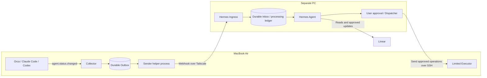

# Orca Webhook Bridge Plugin Specification

> English translation of [spec.ja.md](spec.ja.md). If the two differ, the Japanese original is authoritative.

- Document version: 1.0
- Created / public sources checked: October 21, 2026 (JST)
- Positioning: a design specification for implementation. It does not describe a product or plugin already in operation.
- Target environment: MacBook Air / macOS / Orca / Claude Code and Codex, Hermes Agent on a separate PC, Linear, Tailscale and SSH

## 1. Purpose and principles

Collect the agent status events that Orca on the MacBook Air publishes, and deliver them by webhook to a Hermes Agent running on a separate PC. Hermes organizes the received status and turns it into the necessary notifications, associations with Linear issues, and proposals for operations that require approval.

While the MacBook Air is asleep or offline, connections to and operations on that Mac are skipped. Stored events and held tasks are not discarded; after recovery, those that meet the conditions for their purpose are resent or re-evaluated. Merely receiving an old status event must never cause a previously proposed operation to be executed.

This specification centers on the following five points.

1. Subscribe to `agent.status.changed` and send structured status changes.
2. Save to a local durable queue before any network send.
3. Assume resends, and suppress double processing through receiver-side deduplication and processing records.
4. Separate status notifications from operation requests; write operations go through individual approval and a re-check immediately before execution.
5. Do not mix up what public sources confirm, assumptions about the usage environment, this design proposal, and items to be verified.

## 2. Verification status and grounds

### 2.1 Meaning of labels

| Label | Meaning |
| --- | --- |
| **Confirmed (requirement)** | A premise specified in this request. It does not mean the actual device settings or operating state were confirmed. |
| **Confirmed (public source)** | Information backed by official documentation or public source code as of the check date. There is no guarantee it matches the distribution in use. |
| **Design proposal** | A specification to be implemented in this plugin and surrounding components. Not necessarily a feature of existing products. |
| **To be verified** | Requires checking on the version in use, the actual device, or the integration partner. Until checked, automated operations that depend on that capability are not enabled. |

Unless otherwise noted, all behaviors, numbers, custom fields and endpoints are **Design proposals**.

### 2.2 Confirmed items

| ID | Category | Confirmed content | Grounds and limits |
| --- | --- | --- | --- |
| C01 | Requirement | Orca is used on a MacBook Air, with Claude Code and Codex. | This request. OS and app versions unconfirmed. |
| C02 | Requirement | Hermes Agent runs on a separate PC, Linear is used for issue management, and connectivity is Tailscale + SSH. | This request. The other PC's OS and always-on availability unconfirmed. |
| C03 | Public source | Orca's plugin mechanism is presented as Experimental, with per-plugin enablement and consent. Workers run on the local computer. | [Orca settings reference](https://www.onorca.dev/docs/settings). Availability in the version in use is to be verified. |
| C04 | Public source | The public event set includes `agent.status.changed`, `worktree.created` and `worktree.removed`. | [Manifest definition](https://github.com/stablyai/orca/blob/main/src/shared/plugins/plugin-manifest.ts). |
| C05 | Public source | Required fields of the status event are `worktreeId`, `paneKey`, `state` and `receivedAt`. The current public definition also has an optional `mainAgent`. | [Event definition](https://github.com/stablyai/orca/blob/main/src/shared/plugins/plugin-events.ts). `state` is a string, not an enum. |
| C06 | Public source | `state` is a combined status that includes child agents. The optional `mainAgent` contains the main agent's state, an optional outcome, and the state start time. | Same as above. `mainAgent` is missing on older hosts and on rows without that information. |
| C07 | Public source | Event declarations in the manifest trigger worker startup. Dynamic subscriptions last only for the lifetime of that worker. | [Event bus](https://github.com/stablyai/orca/blob/main/src/main/plugins/plugin-event-bus.ts). This does not mean event history is persisted. |
| C08 | Public source | The public Host API includes `events.subscribe`, storage, secrets, settings, notification display, and input into an explicitly specified terminal. | [Host API](https://github.com/stablyai/orca/blob/main/src/shared/plugins/plugin-host-api.ts). This is different from an API that reads general notifications. |
| C09 | Public source | Orca's agent status hooks are described as reporting `working` / `waiting` / `done` to the UI. | [Agent hooks & memory](https://www.onorca.dev/docs/agents/hooks-memory). Actual transitions in each CLI are to be verified. |
| C10 | Public source | Using regular SSH over the Tailscale network is distinguished from the product feature "Tailscale SSH". The latter has distribution-form conditions for macOS servers. | [Tailscale SSH](https://tailscale.com/kb/1193/tailscale-ssh). This specification uses regular SSH over Tailscale as the baseline. |
| C11 | Public source | Hermes' official documentation describes a webhook receiving feature and a signature scheme. | [Hermes Webhooks](https://hermes-agent.nousresearch.com/docs/user-guide/messaging/webhooks). Availability and configuration in the version in use are to be verified. |
| C12 | Public source | In Hermes' current public code, acceptance and deduplication are handled differently between the normal agent path and paths such as coalesce, cron and direct delivery. | [Webhook implementation](https://github.com/NousResearch/hermes-agent/blob/main/gateway/platforms/webhook.py). Not every 2xx is treated as carrying the same durability guarantee. |

### 2.3 Limits of on-device verification

This specification was built from the request's requirements and primary sources. At the time of writing, the Orca version in use, the actual behavior of event subscription, signed communication and SSH operations had not been verified on the actual device. Links to public sources point at the mutable `main` branch, so the commit corresponding to the version in use is recorded when implementation starts.

See the README for what this repository's implementation has verified and what remains to be verified.

## 3. Roles and architecture

### 3.1 Components

| Component | Runs on | Responsibilities |
| --- | --- | --- |
| Orca | MacBook Air | Work environment for Claude Code and Codex, and the source of status events. |
| Webhook Bridge Collector | Orca plugin worker | Subscription, validation, normalization, state comparison, writing to the durable queue. |
| Webhook Bridge Sender | Helper process of the same user on the MacBook Air | Reading the queue, signing, sending, resending, resuming after recovery. |
| Hermes Ingress | Hermes PC | Signature verification, source allowlisting, durable receipt, deduplication, state projection. Proposed as a new receiving adapter. |
| Hermes Agent | Hermes PC | Summarizing situations, notification policy, referencing issues, drafting operation proposals. |
| Approval Dispatcher / Executor | Hermes side / Mac side | Managing approvals, limited operations over SSH, execution records. Added in the later part of the phased rollout. |
| Linear | Cloud | Recording issues and managing business progress. Not used as an event transport or execution queue. |

Hermes in this document is assumed to be [NousResearch/hermes-agent](https://github.com/NousResearch/hermes-agent). Confirm the actual distribution and installation method before adoption.



### 3.2 Boundary between the plugin alone and the helper process

**The recommended architecture splits the Collector into an Orca plugin and the Sender into a helper process managed by the logged-in user's LaunchAgent or similar.** The Collector and the Sender share a SQLite Outbox in the same Bridge-dedicated directory.

The reason is that the plugin worker's residency, restart after idle reaping, processing right after startup, and access to OS resume events cannot be assumed while unverified. The public worker implementation also contains logic for idle management. [Worker process implementation](https://github.com/stablyai/orca/blob/main/src/main/plugins/plugin-host-process.ts)

The helper process is newly implemented and installed; it is not presented as a standard Orca feature. Its residency and permission to send externally are stated explicitly at setup. Simplifying to a worker-only design is allowed only if it is confirmed on the actual device that "after resume or restart, resending works even without new events".

The Collector's use of SQLite, compatibility with the Node runtime, access to the storage location, and startup management of the helper process are **To be verified**. If they do not hold, switch to an implementation that hands events to a dedicated persistence service over local IPC; even then, the guarantee starts when the service has completed saving.

## 4. Scope and out of scope

### 4.1 Scope

- Collecting `agent.status.changed` and sending it by webhook.
- Associating explicitly mapped worktrees/panes with Linear issues.
- Durable Outbox and Inbox, resending, deduplication, signing, audit logs.
- Skipping and holding while communication is impossible, and resuming sending after recovery.
- Situation awareness, notification aggregation and operation proposals in Hermes.
- In a later phase, limited operations with approval, and checking their results.

### 4.2 Out of scope for the initial version

- Capturing all app notifications in the macOS Notification Center, reading the notification DB, OCR of the screen or notification banners.
- Automatic forwarding of Orca notification bodies, full AI responses, prompts, or full terminal output.
- Private RPC, direct modification of internal DBs, access to other plugins' secrets.
- Automatically completing Linear issues, merging PRs, or deploying to production based solely on `done`.
- Forcibly waking from sleep, keeping a lid-closed Mac always running, executing while powered off.
- A general-purpose remote execution API that accepts arbitrary shell commands.
- Assuming that Orca's normal terminal and an SSH session share the same working state.
- Syncing credentials, sharing Claude Code / Codex subscription information.
- Fully reconstructing every event that could not be observed while stopped.
- Internet-exposed webhooks, Tailscale Funnel, support for other OSes. Designed separately when needed.

## 5. Notifications vs. status events

| Item | macOS displayed notification | Orca status event | Notification created by the Bridge |
| --- | --- | --- | --- |
| Main purpose | Inform a person | Convey status changes to software | Create a message to the user from the status |
| Example | A banner saying "Work has finished" | `agent.status.changed` and structured data | "There are 2 tasks that need review" |
| Influence of UI settings | May be affected by Focus modes, notification permissions, etc. | Not necessarily the same as whether a banner was shown | Follows contacts and notification rules |
| Body retrieval | Not retrieved in this specification | No response body is assumed | Generated from the necessary status fields |
| One-to-one correspondence | No guaranteed match with status events | A single change does not necessarily produce a displayed notification | Can summarize multiple events |

`notifications.show` is an API with which the plugin itself displays a notification; it is not a subscription API for reading existing Orca or macOS notifications. [Orca Host API](https://github.com/stablyai/orca/blob/main/src/shared/plugins/plugin-host-api.ts)

What this specification realizes is the path "convey Orca's status to Hermes, and Hermes processes it". It does not include a guarantee that every notification Orca displays is forwarded as-is.

## 6. Acquiring and interpreting events

### 6.1 Subscription

Declare `agent.status.changed` in the manifest's `contributes.events`. Register the necessary handlers with the SDK at worker startup. Do not rely solely on dynamic `events.subscribe`. The actual SDK registration syntax and whether dynamic subscription is needed in addition to a manifest subscription are confirmed on the version in use.

`worktree.created` / `worktree.removed` are optional subscriptions for future association updates and are not required in the MVP. If subscriptions are added, information additionally obtained, such as paths, is also disclosed as data to be sent.

### 6.2 Handling the source event

| Source field | Content confirmed in the public definition | Handling in the Bridge |
| --- | --- | --- |
| `worktreeId` | String or `null` | Allow `null`. Do not associate it with an unrelated issue by guesswork. |
| `paneKey` | String | Material for identifying the origin. Do not assume it is a secret or a file path; disclose it as data being handled. |
| `state` | String | Store the raw value; normalize only known values for display. |
| `receivedAt` | Positive finite number | Keep the raw value. Convert to a date only after confirming the unit and clock origin on the version in use. |
| `mainAgent` | Optional object | Keep it if present. Its absence is normal on versions that lack it. |
| `mainAgent.state` | String | Managed separately from the combined state. |
| `mainAgent.outcome` | Optional string | Not used for success judgment until the full value set and meanings are confirmed. |
| `mainAgent.stateStartedAt` | Finite number | Derived from the executing host's clock. Compare with the Bridge's observation time directly only with care. |

The above is based on [Orca's public event definition](https://github.com/stablyai/orca/blob/main/src/shared/plugins/plugin-events.ts). Do not forward the entire source definition; select only the necessary fields.

### 6.3 Normalization and judgment

| Observed value | Bridge display state | Possible interpretation | Must not be judged automatically |
| --- | --- | --- | --- |
| `working` | `working` | The agent or a child is running. | That the main agent is necessarily working. |
| `waiting` | `waiting` | Possibly waiting for input, confirmation, etc. | That it is necessarily waiting for permission approval. That the question or approval text can be retrieved. |
| `done` | `done` | Observed as a state where a turn or similar has ended. | Work success, tests passing, issue completion. |
| Unknown string | `unknown` | An unsupported state. | Forcibly mapping it to error or success. |

- If `mainAgent.state=done` arrives while `state=working`, show that a child may still be running.
- Treat a change in `mainAgent` alone as a meaningful event as well. Do not discard it because the combined state is the same.
- Whether dedicated values such as `error`, `failed`, `cancelled` or awaiting-approval exist is to be verified. Do not describe custom event names as existing Orca events.
- Do not assume that Claude Code / Codex identifiers, response bodies, or reliable run IDs are present in the source event. Attach provider information only when it can be confirmed, e.g. by explicit configuration; leave it `null` when undetermined.

## 7. Bridge event contract

### 7.1 Event types

| `event_type` | `kind` | Trigger |
| --- | --- | --- |
| `agent.status.changed` | `state_change` | A new observation received from Orca. |
| `bridge.lifecycle` | `lifecycle` | Sender startup, resume detection, collection failures, start of a configured resync, etc. Bridge-specific. |
| `bridge.observation.snapshot` | `snapshot` | Only when the current state could be obtained through a supported read method. Bridge-specific, later phase. |

Operation requests are not mixed into this event path; use the operation contract in Chapter 15. Heartbeat is an optional health path and must not masquerade as an Orca execution status event.

### 7.2 Common fields

| Field | Required | Specification |
| --- | --- | --- |
| `schema_version` | Required | Version of this contract. Initial value `1`. |
| `event_id` | Required | A UUID or similar generated at the first save. Unchanged across all resends. |
| `event_type` / `kind` | Required | Per §7.1. |
| `observed_at` | Required | RFC 3339 UTC time at which the Bridge observed it. Not a guarantee of when the source event occurred. |
| `source.device_id` | Required | A manually registered, persistent device ID. Does not change when the device name or IP changes. |
| `source.epoch` | Required | Outbox generation ID. Updated only on events such as DB rebuilds; preserved across normal restarts. |
| `source.orca_version` | Required | The version if it could be confirmed, `null` if not obtained. Never filled in by guessing. |
| `source.plugin_version` | Required | Version of the Bridge. |
| `stream.id` / `stream.sequence` | Required | Logical stream of the origin and a persistent, monotonically increasing number. Starts at 1. |
| `context.worktree_id` / `context.pane_key` | Required for status events | Keep the source IDs. `worktree_id` may be `null`. |
| `context.provider` | Optional | `claude_code` / `codex`, etc. `null` without explicit grounds. |
| `context.linear_issue` | Optional | ID and display identifier of a registered issue. `null` if not registered. |
| `data` | Required | Type-specific body. Contains no operation commands. |

`stream.id` is an opaque ID built from the device, generation, worktree, pane and the Bridge-side mapping. If the source data has no reliable session ID, it does not guarantee an agent run ID. If pane reuse or session replacement cannot be detected, require additional confirmation before operations.

`observed_at` and `stream.sequence` represent time and collection order respectively; they do not guarantee business causality or the provider's internal execution order.

### 7.3 Sample status event

The following is an example of this Bridge's own envelope; Orca does not emit this JSON directly. Identifiers are fictitious. The `received_at_raw` number is an example assuming it has been verified to be milliseconds on the version in use.

```json
{
  "schema_version": 1,
  "event_id": "ca387f71-5a2a-4d98-87c7-eed8bda116aa",
  "event_type": "agent.status.changed",
  "kind": "state_change",
  "observed_at": "2026-10-21T01:00:00.000Z",
  "source": {
    "device_id": "macbook-air-01",
    "epoch": "8fa3651a-96b6-4b5c-a154-d8f245848980",
    "orca_version": null,
    "plugin_version": "0.1.0"
  },
  "stream": {
    "id": "stream-71fa3dd7",
    "sequence": 42
  },
  "context": {
    "worktree_id": "wt-example-01",
    "pane_key": "pane-example-02",
    "provider": null,
    "linear_issue": {
      "id": "c357b0a8-8c73-4566-aafc-2b3408f21bf6",
      "identifier": "DEV-123"
    }
  },
  "data": {
    "previous_state": "working",
    "state": "waiting",
    "normalized_state": "waiting",
    "received_at_raw": 1792544400000,
    "main_agent": null,
    "evidence": "orca_plugin_event"
  }
}
```

`previous_state` is the state the Bridge last observed on the same stream; it is `null` if not observed or if there is a gap in collection. Both the source state name and the normalized value are stored. If `main_agent` is present, the source fields are selectively stored with the same names and types, tolerating missing optional fields.

## 8. Durable queue and storage guarantees

### 8.1 Storage method

The proposal adopts a Bridge-dedicated SQLite database, implementing transactions, WAL, appropriate synchronous settings, locking, and recovery at startup. The storage location is kept separate from the install location and the repository.

```text
~/Library/Application Support/OrcaWebhookBridge/
  config.json
  outbox.sqlite3
  logs/
```

This is a storage location proposed by the Bridge, not Orca's standard storage location. The directory is user-only and files are not readable by other users. WAL and shared-memory files are protected likewise. Encryption of SQLite itself is not part of the initial version's guarantees; it relies on minimizing the body and on the OS's protection of the storage area.

By public definition, Orca's Host API storage has limits of 256 KiB per value, 5 MiB total, and 1024 keys. This Key-Value API alone is not treated as sufficient for a large queue and transactional processing. [Host API limit definitions](https://github.com/stablyai/orca/blob/main/src/shared/plugins/plugin-host-api.ts)

### 8.2 Stored information

| Table etc. | Main contents |
| --- | --- |
| `outbox_events` | `event_id`, immutable send-body bytes, body SHA-256, stream, sequence, observation time, status, attempt count, next attempt, last error, delivery target ID. |
| `source_state` | Device and generation, the stream's next sequence, the previous observed value, association information. |
| `source_fingerprints` | Hashes for detecting exact matches of source events, mapped to stored events. |
| `delivery_attempts` | Attempt time, delivery result, HTTP code, a safe summary of the response, trace ID. |
| `runtime_control` | Sending enabled/stopped, leases, configuration revision. No secrets. |

Event registration, sequence allocation, updating the previous state, and registering the exact-match key are done in the same transaction. A mid-way termination must not create states such as "only the sequence advanced" or "only the state was updated and there is no event".

### 8.3 Where the guarantee starts

1. The Collector receives the source event.
2. Input validation, target determination and normalization are performed.
3. A durable commit is made to the Outbox.
4. The event handler completes, and the Sender sends as a separate process.

**Only after step 3 completes can it be called saved.** A crash between steps 1 and 3, events Orca did not emit or deliver, and events during collection downtime are outside the guarantee. Orca's public delivery code has drop handling on delivery failure, so the Bridge cannot guarantee lossless delivery on the host side. [Event delivery implementation](https://github.com/stablyai/orca/blob/main/src/main/plugins/plugin-event-delivery.ts)

Do not wait for network sending or Hermes' processing to complete inside the event handler. If the local write fails, make the collection failure visible. Never continue only the external sending while pretending it was saved normally.

### 8.4 Queue states and limits

```text
pending → inflight → delivered
               └→ retry_wait → inflight
               └→ blocked_config
               └→ dead_letter
```

- `inflight` has a time-limited lease, so unfinished attempts are reclaimed after the Sender terminates abnormally.
- Initial limit proposal: when either 100,000 undelivered events or 256 MiB including DB and WAL is reached, degrade collection and warn. Also set a minimum free disk space.
- Undelivered events are never silently deleted from the oldest. Record the range that could not be saved after the queue filled up as a failure, and show that observation continuity was lost.
- Proposed automatic resend deadline: 30 days from observation. Undelivered events past it are held as expired Dead Letters, and the user decides whether to send or delete them.
- Initial retention proposal: 7 days for delivered bodies, 30 days for delivery attempt logs. Dead Letter bodies are never deleted automatically.
- The receiver's tombstones of `event_id` and body hash for duplicate detection are kept for the source's operational lifetime, to handle old manual resends too. Bodies may be deleted under a separate rule, such as 90 days.
- Capacity and retention periods are adjusted after measurement. Do not use wording that guarantees indefinite losslessness with finite capacity.

## 9. Deduplication and ordering

### 9.1 Two-stage deduplication

**Exact-match elimination before sending**: use a normalized hash of the device, generation, stream and all selected source-event fields, including `receivedAt` and the optional `mainAgent`. If an exact match is received again, map it to the existing event.

Do not key on `state` alone. The two `working`s in `working → waiting → working`, and changes in the main agent only, are separate events. A feature to suppress consecutive observations of the same state stays disabled until the meaning of source events is verified.

**Delivery deduplication on receipt**: use `(source.device_id, source.epoch, event_id)` as the unique key and compare body hashes.

- Same ID, same body: return the existing receipt result; do not re-run notifications or operations.
- Same ID, different body: reject with the equivalent of `409` and record the conflict in the audit log.
- Do not generate a new `event_id` for each resend. Update only the signature headers and attempt information.
- Even if the receiver's response is lost, resend with the same ID. The Sender never marks an event as delivered by guesswork.

### 9.2 Ordering and stale states

- Within the same stream, send one event at a time in order as a rule; different streams may run in parallel.
- The receiver keeps the highest applied sequence per stream. Late-arriving old sequences are kept in history, do not roll back the current state, and cause no new side effects.
- Record missing sequences. Even if a gap arises from a Dead Letter or similar, other streams are not stopped. When the same stream moves ahead, the gap is still shown.
- No total order across devices is built. Clock skew is never used as a substitute for ordering.
- On a generation change, register it as a new stream and do not overwrite the past highest sequence.

Delivery is **designed to aim for at-least-once**, and processing after deduplication is also made idempotent. Exactly-once is not guaranteed for arbitrary external operations.

## 10. Webhook delivery and signing

### 10.1 Path

Send from the Mac to an HTTPS endpoint on the Hermes PC over Tailscale. The proposed base URL is:

```text
POST https://hermes-host.example-tailnet.ts.net/bridge/v1/events
```

The host and path above are a design example. Adapt the certificate, name resolution, Tailscale ACLs/Grants, listen address and host firewall to the real environment. Unrestricted exposure on a publicly reachable `0.0.0.0` is not the default.

HTTPS for webhooks and SSH for Hermes → Mac operations are separate paths. There is no need to keep an SSH session open to send webhooks.

### 10.2 Signature scheme

The proposal adopts a format matching Hermes' published Generic V2. The public documentation describes `X-Webhook-Timestamp` and `X-Webhook-Signature-V2` with a timestamped HMAC-SHA256. [Hermes signature specification](https://hermes-agent.nousresearch.com/docs/user-guide/messaging/webhooks)

```text
Content-Type: application/json; charset=utf-8
X-Request-ID: <event_id>
X-Webhook-Timestamp: <Unix seconds at the time of the send attempt>
X-Webhook-Signature-V2: <64 lowercase hex characters>
X-Bridge-Key-Id: <known key identifier; specific to the Bridge receiving adapter>
X-Bridge-Attempt: <attempt count starting at 1; for monitoring>

signed_bytes = ASCII(timestamp) + "." + raw_body_bytes
signature = hex(HMAC_SHA256(secret_bytes, signed_bytes))
```

- Generate keys from sufficient randomness; the initial proposal is the equivalent of 32 bytes or more. Fix the string representation and encoding used on both sides.
- Do not verify after reformatting the JSON or adding newlines. Sign the **actual bytes** of the stored send body, and verify against the raw body on receipt as well.
- Use constant-time comparison for signatures. Proposed allowed skew is ±300 seconds. Device time synchronization is a precondition.
- Do not reuse old signatures from before sleep. After resume, sign the same body and same ID anew with the current send time.
- Do not change `observed_at`. Distinguish that it is a new delivery of an old occurrence.
- Verify that `X-Request-ID` matches the `event_id` in the signed body. Do not make an unsigned header alone authoritative for duplicate detection.
- The key ID and attempt count headers carry no business authority by themselves. Reject unknown key IDs and do not accept an event before authentication succeeds.
- HMAC authenticates the sender; it does not turn the data body into a safe command.

### 10.3 Secrets and rotation

- Do not store secrets in the Collector's configuration body, the repository, payloads, or normal logs.
- Even if the plugin uses Orca's `secrets` API, do not assume another process can read the same vault directly.
- In the recommended architecture, the Sender uses the user's Keychain or similar, and the Collector need not hold the webhook signing key. How secrets are stored and how the Keychain behaves when locked are to be verified.
- When rotating keys, the receiver temporarily accepts both old and new, and disables the old key after confirming the Sender switched. Bodies and event IDs do not change.
- When sending directly to Hermes' built-in receiver, custom key IDs and multi-key verification may not work as-is. Confirm on the version in use.
- While the key cannot be obtained, hold sending. Never fall back to sending without a signature.

### 10.4 Receipt response

The proposed Bridge Ingress response is:

```json
{
  "status": "accepted",
  "event_id": "ca387f71-5a2a-4d98-87c7-eed8bda116aa",
  "durable": true
}
```

| Condition | Proposed response | Sender handling |
| --- | --- | --- |
| New event durably stored | `202` + `accepted` + matching ID + `durable: true` | Delivered. Hermes' business processing is tracked separately. |
| Existing identical event | `200` + `duplicate` + matching ID + `durable: true` | Delivered. |
| Stopped or out of capacity before durable storage | `503` etc. | Resend. A success response is forbidden. |
| ID and body conflict | `409` | Stop automatic resends; quarantine and investigate. |

Do not treat an arbitrary 2xx, an empty `204`, or a proxy's HTML response as success. Match against the contracted response and ID. `accepted` indicates durable receipt, not completion of summarization, notification or Linear updates.

## 11. Hermes-side receipt and processing

### 11.1 Durable Inbox

The receiver processes in the following order.

1. Check the path, source and size limits.
2. Verify the signature using the raw body and time.
3. Check the JSON schema, allowed device and generation, and that the body ID matches the header ID.
4. Save the Inbox and the duplicate-detection ledger in the same transaction.
5. Return the durable-receipt response.
6. In a separate worker, perform state projection, notification decisions, and processing requests to Hermes.

Inbox processing states are kept as `received` / `processing` / `processed` / `processing_failed`, etc. Hermes downtime, model failures and Linear failures are retried within the Inbox, separately from resends from the Mac. Losing an accepted event is a receiver-side failure; the design does not have the Mac always recover it.

### 11.2 When to use Hermes' built-in webhook

The public documentation's example built-in route is `/webhooks/<route-name>`. This document's `/bridge/v1/events` is a custom receiving contract, not an existing Hermes URL. [Hermes Webhooks](https://hermes-agent.nousresearch.com/docs/user-guide/messaging/webhooks)

The normal agent path in the current public code waits for the result of durable admission to return `accepted` / `duplicate`, and returns `503` when it cannot accept. Coalesce, cron, direct delivery and others are handled differently. [Relevant implementation](https://github.com/NousResearch/hermes-agent/blob/main/gateway/platforms/webhook.py)

At adoption, choose one of the following and record it.

| Approach | Applicable when |
| --- | --- |
| **Recommended: set up a Bridge Ingress** | Satisfy this specification's durable Inbox, long-term duplicate detection and state ordering control in-house, and pass only the necessary events to Hermes. |
| **Simplified: use Hermes' built-in receiver** | When the version and path's durability, deduplication after restart, ID conflicts, processing order and permission limits can be demonstrated. Adapt the response parser to Hermes' actual `delivery_id` etc. |

The public documentation also describes a one-hour duplicate cache, but that alone is not considered to meet the long-term resend requirement. Confirm on the actual device how it relates to the latest code's durable admission, the retention period, and each mode's guarantees. Do not assert either that the feature does not exist or that every mode has the same guarantees.

### 11.3 Processing allowed for Hermes

- Initial phase: storing status, summarizing, drafting user notifications, reading linked issues.
- Outbound notifications run only for the destinations, types and frequencies allowed at setup.
- Treat logs and issue bodies as data; do not regard their wording as operation authority.
- Perform status updates that rules can handle with deterministic processing; do not invoke the LLM for every event.
- Allow only the necessary tools for the Hermes profile that receives webhooks. Do not give the notification profile unrestricted SSH or write permissions.
- Do not build a configuration in which an arbitrarily created receiving route inherits full permissions on the other PC.

## 12. Resending and failure handling

### 12.1 Resend rules

- Initial proposal: 3-second connect timeout, 10 seconds for the whole request.
- Resend waits use exponential backoff plus random jitter; the rough guide is 5 seconds, 15 seconds, 45 seconds, 2 minutes, 5 minutes, then capped at 15 minutes.
- The wait times other than the first are a rough guide; strict timing is not guaranteed. When `Retry-After` is reasonable, respect it as a lower bound.
- Rounds that were not actually sent due to network loss, sleep, etc. are not counted in the delivery attempt count. Rounds that tried to connect and failed are counted.
- When resume or network recovery is detected, try one event per target endpoint, and after recovery flush the queue in order. Avoid mass resending.
- Initial delivery rate proposal: 10 events/second overall, 2 concurrent connections, 1 per stream. Narrow further to match Hermes' acceptable rate.

### 12.2 Handling by error

| Result | Handling |
| --- | --- |
| DNS failure, connection refused, timeout, disconnect | `retry_wait`. Treat as unreachable and thin out re-checks. |
| `408` / `429` / `5xx` | Resend target. Apply `Retry-After` and rate control. |
| `400` / `413` / `422` | Body or contract mismatch. Quarantine to Dead Letter and do not rapidly resend the same body. |
| `401` / `403` | Check signature, time, permissions and stop settings. Temporarily pause the endpoint as `blocked_config`. |
| `404` | Check URL and route configuration. Hold until the configuration is fixed. |
| `409` | Quarantine as an ID collision / body conflict. |
| `3xx` | Do not follow automatically. Require a configuration fix, preventing the signed body from leaking to another destination. |
| TLS certificate error | Hold the endpoint and warn. Never switch to disabling verification. |
| Invalid success response / ID mismatch | Do not mark as delivered. Thin out retries and show the contract mismatch. |

When the endpoint URL changes, do not automatically forward existing events to an unrelated new URL. Keep the endpoint ID bound to the queue, and present to the user the events to be migrated and the new destination.

## 13. Sleep, offline and resume

### 13.1 Definition of "skip"

A skip means **not making this connection or operation attempt and holding the necessary record**; it does not mean deleting or completing events or issues.

| Situation | Event sending on the Mac | Connections/operations from Hermes to the Mac |
| --- | --- | --- |
| Mac running, Orca running, both PCs reachable | Send in order after saving. | Reads within the allowed scope. Writes after approval. |
| Mac running but offline | Status events are saved. Sending is held. | If unreachable, skip this time. Set the task to `deferred_unreachable`. |
| Mac asleep | Continued execution and new collection are not guaranteed. The stored Outbox is kept. | Skip as unreachable. Do not conclude whether it is sleep or network loss. |
| Mac shut down | Same as above. No processing while powered off. | Hold. Do not force startup. |
| Mac running, only Orca quit | The Sender can send the stored Outbox. New Orca event collection stops. | Do not treat an SSH connection alone as meaning the Orca target is operable. |
| Hermes PC stopped | Accumulates in the Mac's Outbox. | Hermes processing also stops. Resumes after recovery. |
| Mac resumed, network not yet recovered | The Sender waits for reachability and checks at low frequency. | Hold until actual reachability is confirmed. |
| Keychain locked | Signed sending is held. | Hold if approval or execution keys cannot be used. |

### 13.2 Resume procedure

1. Triggered by Sender startup, resume detection, a lightweight check with a period of at most 60 seconds, etc., reclaim expired leases.
2. Check whether sending is enabled, DB health, keys, endpoint, time synchronization, and network.
3. Resend undelivered events with the same event IDs and bodies, with new signatures.
4. Hermes accepts past events as history and updates the latest display from the order and observation times.
5. If a usable method of obtaining the current state exists, resync. If not, display it as "state as of last observation".
6. Re-evaluate held tasks for target, deadline, approval and current state, and advance only valid ones to the next stage.

Post-resume resending is guaranteed by design for **events already durably saved**. Events that did not occur during sleep, or changes missed while Orca was quit, are not fabricated. A snapshot of the current state also does not amount to restoring the history of the gap.

### 13.3 Reachability and notification suppression

- Hermes does not conclude "the Mac went to sleep" solely from missing heartbeats; it treats it as `unreachable` / `unknown`.
- Heartbeat proposal: 60-second interval; missing for more than 180 seconds makes reachability unknown. Business status is kept separately.
- Report Sender liveness and Collector/Orca liveness as separate items. Even if the Sender is running, do not show "Orca's status is up to date".
- Do not notify the user every time there is a momentary outage. Notify in aggregate for sustained failures, recovery, queue growth, or when user action is needed.
- Do not send past `waiting` etc. as urgent notifications as-is on resume. Summarize past changes and check whether action is still needed now.

### 13.4 Held tasks on the Hermes side

Tasks that depend on the Mac store, in a durable ledger on the Hermes side, `task_id`, target device, proposed operation, reason for holding, next scheduled check, expiry, and approval reference. Do not create the same task anew at every periodic check; update the existing held record.

After resume, read tasks resume after checking the target and deadline, and write tasks re-verify the approval in Chapter 15. Resuming tasks and redelivering operation requests are processes separate from resending past status events. Hermes-side summaries and issue references that do not need a connection to the Mac can continue unless there are other dependencies.

## 14. Tailscale + SSH connection

### 14.1 Connection method

The baseline is connecting to the Mac's regular SSH server by its Tailscale address / MagicDNS name. macOS provides SSH connections through "Remote Login". [Apple's Remote Login description](https://support.apple.com/guide/mac-help/allow-a-remote-computer-to-access-your-mac-mchlp1066/mac)

If adopting "Tailscale SSH", perform a separate compatibility check. Official material states that macOS servers require the open-source `tailscale` + `tailscaled` build, so do not assume the same feature works with the App Store version etc. [Tailscale's conditions](https://tailscale.com/kb/1193/tailscale-ssh)

### 14.2 Operational constraints

- Restrict source, destination, user and port, and do not grant unnecessary root access.
- With regular SSH, use dedicated keys and host key verification. Do not ignore unknown or changed host keys.
- Unattended reachability checks use short timeouts and do not stall on interactive password prompts.
- Administrator privileges, screen control and Full Disk Access are not initial requirements.
- Whether non-interactive SSH can reach the logged-in user's Orca CLI or GUI session is to be verified. Record connection success and operation success separately.
- As a rule, use a fixed Executor and structured JSON. Do not concatenate externally sourced issue bodies or IDs into shell commands.

This specification defines the connection method; writing this document does not change Remote Login or Tailscale settings.

## 15. Operations with approval

### 15.1 Permission levels

| Level | Examples | Conditions for permission |
| --- | --- | --- |
| Status collection / receipt | Storing events, displaying status | Sending scope and destination allowed at installation. |
| Read | Referencing related issues, allowed status queries | Read permission limited to targets. |
| Outbound contact | Aggregated notifications to a designated channel | Destinations, content and frequency explicitly allowed in configuration. Unallowed destinations require individual approval. |
| Write / execute | Additional instructions to an agent, retry, stop, issue updates | Explicit approval per operation and target, and verification immediately before execution. |
| Out of initial scope | Merge, deploy, permission changes, retrieving secrets | Not enabled by a general permission. Requires a separate specification. |

Orca's plugin installation consent, Tailscale SSH connection authorization, and approval of specific operations are different things. Do not design it so that `terminal:send` consent at installation alone makes all subsequent input user-approved.

### 15.2 Approval flow

1. Hermes drafts a proposed operation based on an event.
2. On an authenticated approval screen/channel, present the target device, worktree, pane, issue, operation content, expected changes, and deadline.
3. The user explicitly approves that proposed operation. A status event or LLM output alone does not count as approved.
4. The Dispatcher verifies the approval record and checks the target Mac's reachability and the current target state.
5. The Executor runs only allowed operations and records the result in the operation ledger.
6. Hermes checks the result and reports / updates the issue within the approved scope.

The approval screen, authentication, notification destinations and approval records are areas newly designed here; do not assert that Orca's existing APIs provide the same UI.

### 15.3 Sample operation request

The following is an example at the stage of proposing an additional instruction. It is `pending`, so it cannot be executed. Mapping to actual Orca commands is to be verified.

```json
{
  "schema_version": 1,
  "command_id": "827dca1f-9748-4c65-9c46-3818782c5c13",
  "trigger_event_id": "ca387f71-5a2a-4d98-87c7-eed8bda116aa",
  "action": "agent.send_instruction",
  "target": {
    "device_id": "macbook-air-01",
    "source_epoch": "8fa3651a-96b6-4b5c-a154-d8f245848980",
    "stream_id": "stream-71fa3dd7",
    "worktree_id": "wt-example-01",
    "pane_key": "pane-example-02"
  },
  "parameters": {
    "text": "Please summarize the current test results for DEV-123."
  },
  "preconditions": {
    "expected_sequence": 42,
    "expected_state": "waiting",
    "require_live_target_check": true
  },
  "approval": {
    "status": "pending",
    "approval_id": null,
    "approved_by": null,
    "approved_at": null,
    "expires_at": "2026-10-21T01:15:00Z"
  }
}
```

### 15.4 Safety of resends and execution

- Bind the approval to the `command_id`, the exact target, the hash of the parameters, the preconditions and the expiry. If the body or target changes after approval, re-approve.
- Do not trust the payload's `approval.status` or `approved_by` alone. The Executor verifies the approver, target, content and expiry by querying a trusted approval ledger or with a signed proof of approval. Do not give the Webhook body or the LLM itself the authority to issue approvals.
- Initial proposal for approval validity: 15 minutes. If resume happens after that, mark it `expired` and do not execute with the old approval.
- While offline, hold as `deferred_unreachable`. Coming back online is not a substitute for approval.
- If any of the sequence number, state or target has changed, recreate the proposed operation and re-approve. If the source event has no run ID, confirm the target's continuity separately.
- The Executor records the `command_id` and parameter hash in a durable ledger. For a re-arrival of a completed request, return the stored result.
- If it is "unknown whether it executed" due to an SSH disconnect or similar, mark it `outcome_unknown` and do not automatically repeat the same input. Check the execution record and target state.
- Acceptance of terminal input does not guarantee that the agent started execution or completed the work. Distinguish `accepted`, `started` and `completed`.
- If the operation API has no idempotency or reliable run ID, a complete single execution of external side effects is not guaranteed.
- Even in implementations that use `terminal.sendText`, specify the target terminal explicitly and do not input unconditionally into the focused terminal. Do not enable operations for which a safe mapping from pane to terminal ID cannot be made.

## 16. Linear integration

Linear is the source of truth for issue management, kept separate from the agent status the Bridge carries. Linear's official API is provided as GraphQL. [Linear API](https://linear.app/developers/graphql)

- Register an issue's internal ID and display identifier from the user's explicit specification or from a verifiable existing mapping table.
- Do not determine an issue solely from a branch name, worktree name or free text. Keep it as a candidate and allow the unregistered state.
- Allow multiple panes/agents to be involved in one issue. Do not complete the issue on one of them being `done`.
- `working` / `waiting` / `done` are observations of agent execution, a state system separate from Linear's Todo / In Progress / Done.
- The initial version goes as far as reading and drafting updates. Adding comments, changing status and creating issues go through individual approval.
- Separate external API success/failure from event receipt; do not revoke the event Inbox's receipt because of a Linear failure.
- Suppress duplicate posts of writes such as comments by combining a processing ledger, identification markers and after-the-fact queries. Do not assume Linear has idempotency keys for every operation.
- If Linear updates return to Hermes through another integration, keep `origin` and correlation IDs to prevent circular processing.
- Linear credentials are managed only on the Hermes side and never placed in the Mac's status events.

## 17. Orca plugin and configuration proposal

### 17.1 Proposed installation procedure

1. Record the versions of Orca, macOS, Claude Code, Codex and Hermes in use.
2. In Orca's Settings → Plugins, confirm whether the Experimental mechanism can be used.
3. Install the Bridge locally or through an official distribution method, review the requested capabilities, and enable it.
4. Install the Sender helper process separately from the Collector, and configure launch at login, storage location, destination and secret storage.
5. Disable external sending for the whole Bridge by default, and enable it after confirming the destination and content of test events.
6. Start with dry-run, and test durable receipt, signing, deduplication and resume.

Operations whose correspondence to the existing SDK or settings screen is unclear are not presented as installable, finished features.

### 17.2 Proposed manifest

The following is a structural example matching the public manifest definition; it has not been verified to install on the version in use. Replace `publisher` with the actual distributor ID and `engines.orca` with the minimum version established by compatibility testing. The example's `>=1.4.0` is not a value that guarantees compatibility.

```json
{
  "manifestVersion": 1,
  "id": "webhook-bridge",
  "publisher": "local",
  "name": "Webhook Bridge",
  "version": "0.1.0",
  "description": "Forward selected Orca agent status events to a private Hermes receiver.",
  "engines": {
    "orca": ">=1.4.0"
  },
  "pluginApi": 1,
  "main": "dist/main.mjs",
  "contributes": {
    "events": [
      {
        "on": "agent.status.changed"
      }
    ]
  },
  "capabilities": [
    {
      "kind": "events:subscribe"
    },
    {
      "kind": "settings:own"
    }
  ]
}
```

See the public [manifest definition](https://github.com/stablyai/orca/blob/main/src/shared/plugins/plugin-manifest.ts) and [capability definition](https://github.com/stablyai/orca/blob/main/src/shared/plugins/plugin-capabilities.ts).

- In the example, `capabilities` is an array of `{ "kind": ... }`. Do not add `net:fetch`, `filesystem:write`, `process:exec` etc. on the assumption that they are currently valid permission names.
- Add `storage` when using Orca's Key-Value storage and `secrets` when using its vault. This declaration does not mean SQLite or the Sender's Keychain access is permitted.
- Add `notifications:show` only when implementing Mac-side notifications. Add `workspace:read` too only after verifying the need and scope of retrieval.
- `terminal:send` is not requested in the MVP. When adding operation features, explain the need, target restriction and individual approval.
- A Node worker running, capability checks by the public Host API, and the whole OS being strictly sandboxed are not the same thing. Make the trust boundary of the helper process and direct file I/O explicit.

### 17.3 Proposed Bridge-specific configuration file

The following is **a proposal for a `config.json` interpreted by this Bridge itself**, not Orca's standard configuration keys. `bridgeConfigVersion` and Orca's `manifestVersion` are separate versions.

```json
{
  "bridgeConfigVersion": 1,
  "enabled": false,
  "mode": "dry_run",
  "source": {
    "deviceId": "macbook-air-01"
  },
  "collector": {
    "events": ["agent.status.changed"],
    "scope": {
      "worktreeIds": [],
      "paneKeys": [],
      "includeUnscoped": false
    },
    "includeMainAgent": true,
    "includeTranscript": false,
    "unknownStatePolicy": "forward_as_unknown"
  },
  "sender": {
    "runAs": "user_launch_agent",
    "resumeCheckIntervalSeconds": 60,
    "endpointId": "hermes-private-01",
    "endpointUrl": "https://hermes-host.example-tailnet.ts.net/bridge/v1/events",
    "allowedHosts": ["hermes-host.example-tailnet.ts.net"],
    "followRedirects": false,
    "connectTimeoutSeconds": 3,
    "requestTimeoutSeconds": 10,
    "maxConcurrentRequests": 2,
    "maxRequestsPerSecond": 10,
    "signing": {
      "scheme": "generic_hmac_v2",
      "keyId": "bridge-key-01",
      "secretRef": "keychain:orca-webhook-bridge/hermes-private-01"
    },
    "retry": {
      "initialDelaySeconds": 5,
      "maxDelaySeconds": 900,
      "jitter": true,
      "maxEventAgeDays": 30
    }
  },
  "queue": {
    "engine": "sqlite",
    "directoryRef": "user_application_support/OrcaWebhookBridge",
    "maxUndeliveredEvents": 100000,
    "maxDiskBytes": 268435456,
    "maxPayloadBytes": 16384,
    "deliveredRetentionDays": 7,
    "attemptLogRetentionDays": 30,
    "overflowPolicy": "stop_collection_and_alert"
  },
  "context": {
    "providerByPaneKey": {},
    "linearIssueByStreamId": {}
  },
  "actions": {
    "enabled": false,
    "requireExplicitApproval": true,
    "approvalTtlSeconds": 900,
    "offlinePolicy": "defer_and_revalidate",
    "allowedActionTypes": []
  }
}
```

The settings mean the following.

- `enabled: false` stops the whole Bridge: it stops collection and new sending, and keeps the existing queue. Registering targets and setting `enabled: true`, `mode: dry_run` lets you check the consistency of collection, planned deliveries and signing configuration without actually sending.
- An empty `scope` means **no collection targets**, not all targets. Explicitly register worktrees or panes; if both are specified, restrict to those satisfying both conditions.
- `includeUnscoped: false` is the proposal to exclude `worktreeId=null` by default. Collect them only when explicitly allowed.
- `includeTranscript: false` is always kept in this specification. Changing it to `true` alone does not unlock body forwarding; that requires a separate design and additional consent.
- `keychain:` and `directoryRef` are reference notations implemented by the Bridge, not existing Orca syntax.
- `providerByPaneKey` is an identification aid and is invalidated when a pane is reused. Unconfirmed values are not automatically inferred as Claude Code / Codex.
- Apply configuration atomically, and detect unknown required keys, invalid URLs, secrets written inline, etc. Record change history excluding secrets.

### 17.4 Proposed settings / management screen

Show the destination, target scope, collection status, sending status, undelivered count, oldest undelivered time, last success, scheduled retry, Dead Letters, and freshness of the current state. Provide test sends, a whole-bridge stop, resume, selective resend, and safe log export.

Whether arbitrary communication from Orca's plugin panel to the worker, real-time queue display, and a custom settings form are possible on the version in use is to be verified. If not, provide them through the Bridge's local management UI or similar, without assuming Orca APIs that do not exist.

Disabling the Collector and stopping the Sender are separate operations. In a configuration where disabling only the Collector lets stored events continue to be sent, show that fact. **"Whole-bridge stop" stops both the Collector's collection and the Sender's new sending, and keeps the queue.** Record that the one event being sent may already have reached the receiver.

## 18. Security, data minimization and auditing

- Send only status and the necessary identifiers. Absolute paths, remote URLs, prompts, response bodies, environment variables, API keys and terminal output are excluded by default.
- Even if issue names, branch names, etc. are added later, do not treat display strings as commands.
- Pin destination hosts with an allowlist; do not let the event body specify the delivery URL.
- The receiver registers known devices and generations, and does not unconditionally accept an unknown device that merely holds the secret.
- Protect the local DB and logs with user-only permissions. Do not include signing keys, authentication headers or unnecessary body details in diagnostic output either.
- Separate the webhook signing key, SSH keys, Linear token and approval credentials by purpose.
- The audit log records event IDs, operation IDs, targets, approver IDs, approval times, configuration revisions and attempt results. It does not record secrets or approval tokens themselves.
- Keep notification and operation processing ledgers separate from received events, so you can trace which event led to which side effect.
- Plugin stop, Sender stop, key revocation and receiving-route stop are independent means of stopping.

## 19. Phased rollout

| Phase | What is introduced | Condition to advance |
| --- | --- | --- |
| Phase 0: Compatibility check | Recording versions, measuring events, checking the SDK, storage, worker lifetime, SSH and Hermes receipt. | Record the required items in Chapter 21 and choose an architecture that holds on the version in use. |
| Phase 1: Collection only | Dry-run on one worktree/pane. Local storage and status display only. | Confirm transitions, unknown values and presence/absence of `mainAgent` for both Claude Code and Codex. |
| Phase 2: One-way delivery | Signed webhooks, Outbox/Inbox, resending, resume, deduplication. | Saved events are recovered even through network loss, restarts and lost responses. External operations disabled. |
| Phase 3: Notifications and reads | Allowed notifications, aggregation, issue references, limited checks of the current state. | No excessive notifications, no misleading display of stale states, no permission overreach. |
| Phase 4: Operations with approval | Start with a single operation type. Approval, expiry, target matching, execution ledger. | Pass every rejection condition: unapproved, expired, target changed, execution unknown. |

On failure, stop write features first so that status collection and queue preservation can be maintained. For plugin updates, check compatibility of the manifest, SDK and DB migrations, and never perform a rollback that destroys the DB.

## 20. Acceptance criteria

The following are pass/fail conditions for the implementation; they do not mean testing has been done at this point. Up to Phase 2 is the MVP of the notification foundation, and operation-related items are additional pass conditions for Phase 4.

| ID | Target | Test / expected result |
| --- | --- | --- |
| A01 | Subscription | Collect `agent.status.changed` for the selected worktrees/panes; do not send unallowed targets outside. An empty target configuration does not result in collecting everything. |
| A02 | Both CLIs | Store the `working` / `waiting` / `done` actually measured on each of Claude Code and Codex; do not fabricate unobserved values. |
| A03 | Version compatibility | Accept both events with only the basic four fields and events with `mainAgent`. |
| A04 | State meaning | Store changes of the main agent even while the combined state remains `working`. Do not treat `done` alone as success or issue completion. |
| A05 | Unknown values / null | Handle unknown states as `unknown` with the raw value. When allowed by configuration, handle `worktreeId=null` without crashing. |
| A06 | Notification separation | Collect without depending on macOS banners being shown. Do not require a one-to-one correspondence between events and banners. Do not collect notification bodies. |
| A07 | Atomic save | Even if the process is stopped in the middle of sequence allocation, state update and Outbox save, the transaction recovers to a consistent state. |
| A08 | Stop before send | Even if stopped right after durable save and right before sending, send with the same ID and body after restart. Loss before saving is recorded as outside the guarantee. |
| A09 | Network loss | Keep the Mac running and block communication for 30 minutes; resend the stored target events after recovery. |
| A10 | Sleep resume | Put the Mac to sleep with undelivered events left; after resume, resending starts without any new Orca status change. |
| A11 | Reboot resume | After a Mac reboot and re-login, the helper process recovers undelivered events. Stored events can be sent even if Orca is not running. |
| A12 | Receiver stopped | Accumulate in the Outbox while the Hermes side is stopped, and recover after the receiver comes back. |
| A13 | Lost response | Discard only the response after the receiver saved it, forcing a resend; notifications and processing requests for the same event are not duplicated. |
| A14 | Receiver restart | Stop the receiver right after receipt or mid-processing, and recover from the Inbox and duplicate-detection ledger. Do not reissue completed side effects. |
| A15 | Long-term duplicates | Treat resends of the same ID as duplicates even after 24 hours or more. Also check the limit of the adopted retention policy. |
| A16 | Ordering | Deliver in reversed order; an old sequence does not roll back the latest state. Other streams are not stopped. |
| A17 | ID conflict | Sending a different body with the same ID is rejected and quarantined, not accepted as success. |
| A18 | Signature | Reject a tampered body, invalid signature, unknown key, out-of-window time, and mismatch between body ID and header ID. |
| A19 | Post-resume signature | Deliver an event saved several hours ago normally with a new signing time and the same event ID. |
| A20 | Key management | Key rotation and old-key revocation, and holding while the Keychain is locked, work, and secrets do not appear in logs. |
| A21 | Resend control | Resend with thinning on `429`, `5xx` and timeouts; `401` etc. put the configuration on hold. Redirects are not followed. |
| A22 | Limits | On queue full, disk shortage or size overflow, do not silently delete undelivered events; show the collection failure and the affected range. |
| A23 | Receipt contract | Do not return success before durable save. The Sender does not mark an invalid 2xx or an ID mismatch as delivered. |
| A24 | Recovery display | Do not assert an old `waiting` etc. as a current request for action. Show last observation, Collector liveness and device reachability separately. |
| A25 | Stop | A whole-bridge stop stops collection and new deliveries and keeps the queue. Show the difference from stopping the Collector alone. |
| A26 | Linear | Link multiple panes to one issue, and do not complete it when one becomes `done`. Do not perform unapproved writes. |
| A27 | Approval | Reject operations that are unapproved, forged, expired, or with changed parameters. |
| A28 | Offline operations | Hold while the Mac is unreachable, and do not execute merely on resume. Re-verify the approval expiry, current target and state. |
| A29 | Target matching | Even after SSH succeeds, do not execute if the continuity of the target worktree, pane, terminal and session cannot be confirmed. |
| A30 | Operation duplicates | Do not re-execute a completed request with the same `command_id`. If the result is unknown due to an SSH disconnect, mark it `outcome_unknown`. |
| A31 | Input permission separation | Even if issue bodies or event bodies contain operation commands, no SSH or writes happen without permission and approval. |
| A32 | Notification volume | Aggregate identical failures and short-lived status changes; do not generate a flood of past notifications on resume. |

The proposed performance target is "95% from local save to durable receipt on the receiver within 5 seconds" in a normal unloaded, online environment. Sleep, bandwidth limits, backoff and Hermes' summarization time are measured separately. Values are adjusted after measurement.

## 21. Items to verify before implementation

| ID | What to check | How to check / handling if it does not hold |
| --- | --- | --- |
| V01 | Orca version in use and API support | Check the settings screen, an executable CLI and the corresponding source, and record the commit. If unsupported, do not proceed with adoption. |
| V02 | Plugin SDK, subscription, handlers | Measure startup, receipt, disabling and re-enabling with a minimal plugin. Do not implement by guessing API names. |
| V03 | State values, time units, main agent information | Test waiting for input, completion, interruption, and children continuing on both CLIs. Record the unit and clock origin of `receivedAt` etc. |
| V04 | Provider / session identification | Check whether it can be obtained through the public API. If not, adopt `null` and manual mapping, and disable ambiguous operations. |
| V05 | SQLite, Node, storage access | Verify DB, WAL, contention and crash recovery in the distributed app's runtime. Switch to a persistence service if needed. |
| V06 | Worker lifetime | Check idle, quit, Orca restart and OS resume. If it cannot resend automatically on its own, adopt the Sender helper process. |
| V07 | Helper process and secrets | Check LaunchAgent startup/shutdown, Keychain lock, permissions and behavior on update. |
| V08 | Reading / resyncing the current state | Check whether a stable API/CLI exists. If not, stay with last-observation display and keep operations pending further verification. |
| V09 | Hermes version in use and receiving mode | Check HMAC V2, path, durable admission, duplicate ledger, retention and the meaning of 2xx. Cover shortfalls with the Bridge Ingress. |
| V10 | Hermes permissions and approval | Check tool restrictions of the receiving profile, approver authentication and approval records. Do not permit operations by signature alone. |
| V11 | Tailscale and SSH | Check distribution form, name resolution, ACLs/Grants, keys, non-interactive connections and reachability of the logged-in Orca. |
| V12 | Operation API | Verify target restriction, result queries and idempotency. If insufficient, stay at notifications and proposals. |
| V13 | Management UI and whole-bridge stop | Check whether control from the panel is possible and the linkage between Collector and Sender stops. If unsupported, make it explicit in a dedicated management UI. |
| V14 | Linear permissions and mapping table | Check team, issue IDs, state IDs and authentication scopes. Do not update with fixed state names. |

These are not unfinished parts of the document but verification items that decide whether to adopt the implementation. When changing based on verification results, update the specification version, the supported-version table and the acceptance results.

## 22. Primary sources

All referenced on October 21, 2026. The contents of mutable branches and of the actually distributed Orca/Hermes may differ.

- [Orca Settings reference: Experimental plugins](https://www.onorca.dev/docs/settings)
- [Orca Agent hooks & memory](https://www.onorca.dev/docs/agents/hooks-memory)
- [Orca plugin-manifest.ts](https://github.com/stablyai/orca/blob/main/src/shared/plugins/plugin-manifest.ts)
- [Orca plugin-events.ts](https://github.com/stablyai/orca/blob/main/src/shared/plugins/plugin-events.ts)
- [Orca plugin-host-api.ts](https://github.com/stablyai/orca/blob/main/src/shared/plugins/plugin-host-api.ts)
- [Orca plugin-capabilities.ts](https://github.com/stablyai/orca/blob/main/src/shared/plugins/plugin-capabilities.ts)
- [Orca plugin-event-bus.ts](https://github.com/stablyai/orca/blob/main/src/main/plugins/plugin-event-bus.ts)
- [Orca plugin-event-delivery.ts](https://github.com/stablyai/orca/blob/main/src/main/plugins/plugin-event-delivery.ts)
- [Orca plugin-host-process.ts](https://github.com/stablyai/orca/blob/main/src/main/plugins/plugin-host-process.ts)
- [Hermes Agent official repository](https://github.com/NousResearch/hermes-agent)
- [Hermes Webhooks](https://hermes-agent.nousresearch.com/docs/user-guide/messaging/webhooks)
- [Hermes gateway/platforms/webhook.py](https://github.com/NousResearch/hermes-agent/blob/main/gateway/platforms/webhook.py)
- [Tailscale SSH](https://tailscale.com/kb/1193/tailscale-ssh)
- [Apple: Allow a remote computer to access your Mac](https://support.apple.com/guide/mac-help/allow-a-remote-computer-to-access-your-mac-mchlp1066/mac)
- [Linear GraphQL API](https://linear.app/developers/graphql)
